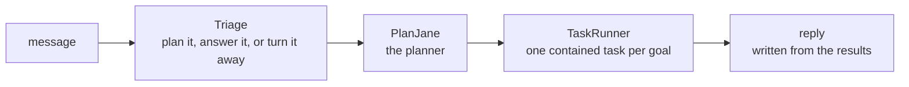

# BookShelf

BookShelf is a chat assistant for a fixed book shelf. Ask it for books by an author, books on a subject, books like one you liked, or books under some page count, and it answers only from that shelf.

**Try it:** [tuanqpham0921.web.app](https://tuanqpham0921.web.app)

## Why it is built this way

BookShelf deliberately does not search the internet or rely on what the model already knows about books. Every answer comes from its own catalog, which brings three things:

- **Control:** the model cannot recommend a book that isn't in the inventory or invent facts about one.
- **A visible plan:** each message becomes a short plan of contained tasks, such as "find books by this author" or "keep the ones under 300 pages".
- **Something to measure:** each task can be checked on its own, and the planner is graded against expected plans.

## Transparent by design

BookShelf tries to hide nothing about how it reached an answer. You can look through the AI rather than at it:

- **The plan comes first,** drawn as a diagram before any task runs.
- **Every task shows its work:** the arguments the model parsed from your message, the SQL it ran, how many books matched, the time and tokens it took, and a preview of what it found.
- **The whole trace is yours:** the log button shows every step of the turn, and a project answer lists the docs it came from.
- **Failures are explained, not hidden:** a step that found nothing or broke says so, and the reply tells you why.
- **The code and docs are open,** and the chatbot answers questions about BookShelf from those same docs.

## Vocabulary

**A turn**, in the order it runs:

| Term | Meaning |
|---|---|
| **Triage** | decides whether a message needs a plan at all |
| **Promoted tool** | a node triage can call directly, so a common ask skips the planner; an optimization, like triage's plan cache |
| **PlanJane** | the planner: turns a message into goals, one node each, and draws the plan |
| **Goal** | one step of a plan: a node, its instruction, and the goals it depends on |
| **TaskRunner** | runs the goals in dependency order |
| **Reply stage** | writes the answer from every goal's result, once per turn |

**Nodes**, what the planner plans with:

| Term | Meaning |
|---|---|
| **Node** | one capability, run like a small agent: it reads an instruction, calls its own tools and returns a typed output |
| **Tool** | a schema an LLM fills in one call; the atomic unit of LLM work |
| **Catalog** | the set of nodes the planner can pick from |
| **Spec** | a node's entry in the catalog: its name, the description the planner reads, and what goes in and comes out |
| **Slice** | the folder holding one node: its spec, schemas and executor |
| **`external.py`** | a slice's schemas for what goes into and out of the node |
| **Executor** | the code that runs a node |
| **Anchor / candidate** | books the user named, versus books that match a description |

**Tracing:**

| Term | Meaning |
|---|---|
| **airglider** | the tracing and execution engine every step runs under |
| **Envelope** | airglider's record of one step: input, output, ok, timing, tokens and child steps |

## Where to go

| To | Read |
|---|---|
| run the backend, or deploy it | [backend/](backend/README.md) |
| run the frontend, or deploy it | [frontend/](frontend/README.md) |
| see how a request flows through the app | [backend/app/](backend/app/README.md) |
| see what the planner is and how it plans | [PlanJane](backend/app/domains/planjane/README.md) |
| see how every step is traced | [airglider](backend/airglider/README.md) |
| learn where the books come from | [the dataset](backend/data/README.md) |
| learn about the database and its schema | [db/](backend/db/README.md) |
| run or read the evals | [evals/](backend/evals/README.md) |
| read what V1 does, its limits and what comes next | [V1 release](docs/v1_release.md) |
| see why things are built the way they are | [decisions](docs/decisions/README.md) |
| see how evals, deployment, the database and new nodes are approached | [strategies](docs/strategies/README.md) |
| find known bugs and small follow-ups | [backlog](docs/backlog.md) |
| write or edit docs here | [documentation strategy](docs/strategies/documentation.md) |

## Built with

Python, FastAPI, PostgreSQL with pgvector and OpenAI on the backend; React and Vite on the frontend. It is deployed on Cloud Run, Neon and Firebase Hosting.

## License

MIT, see [LICENSE](LICENSE). Feedback is welcome at tuanqpham0921@gmail.com.
