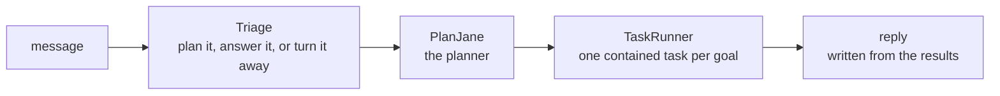

# BookShelf

BookShelf is a chat assistant for a fixed book shelf. Ask it for books by an author, books on a subject, books like one you liked, or books under some page count, and it answers only from that shelf.

**Try it:** [tuanqpham0921.web.app](https://tuanqpham0921.web.app)

## Why it is built this way

BookShelf deliberately does not search the internet or rely on what the model already knows about books. Every answer comes from its own catalog, which brings three things:

- **Control:** the model cannot recommend a book that isn't in the inventory or invent facts about one.
- **A visible plan:** each message becomes a short plan of contained tasks, such as "find books by this author" or "keep the ones under 300 pages". The plan is drawn as a diagram before anything runs, and each task shows what it did: the arguments it parsed, the SQL it ran, what it cost.
- **Something to measure:** each task can be checked on its own, and the planner is graded against expected plans.

## Where to go

| To | Read |
|---|---|
| run the backend, or deploy it | [backend/](backend/README.md) |
| run the frontend, or deploy it | [frontend/](frontend/README.md) |
| see how a request flows through the app | [backend/app/](backend/app/README.md) |
| see what the planner is and how it plans | [PlanJane](backend/app/domains/planjane/README.md) |
| see how every step is traced | [airglider](backend/airglider/README.md) |
| learn where the books come from | [the dataset](backend/data/README.md) |
| learn about the database and its schema | [db/](backend/db/README.md) |
| run or read the evals | [evals/](backend/evals/README.md) |
| read what V1 does, its limits and what comes next | [V1 release](docs/v1_release.md) |
| see why things are built the way they are | [decisions](docs/decisions/README.md) |
| see how evals, deployment, the database and new nodes are approached | [strategies](docs/strategies/README.md) |
| find known bugs and small follow-ups | [backlog](docs/backlog.md) |
| write or edit docs here | [documentation strategy](docs/strategies/documentation.md) |

## Built with

Python, FastAPI, PostgreSQL with pgvector and OpenAI on the backend; React and Vite on the frontend. It is deployed on Cloud Run, Neon and Firebase Hosting.

## License

MIT, see [LICENSE](LICENSE). Feedback is welcome at tuanqpham0921@gmail.com.
