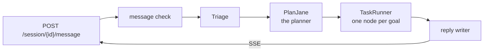

# backend

BookShelf's backend is the FastAPI service behind the chat. It checks each message, plans it with PlanJane, runs the plan against a Postgres catalog of 5,197 books, and streams the steps and the reply back over server-sent events.



## Built with

| | |
|---|---|
| Python 3.12, FastAPI, Poetry | the service; [app/](app/README.md) |
| PostgreSQL + pgvector | the book catalog, sessions and recorded turns; [db/](db/README.md) |
| OpenAI | every LLM call, the book embeddings and the project-docs vector store; [clients/](clients/README.md) |
| [airglider](airglider/README.md) | BookShelf's own tracing library: every workflow and step is recorded as a tree |
| [PlanJane](app/domains/planjane/README.md) | the planner: turns a message into goals, one node per goal, and draws the plan |
| Cloud Run, Neon | where it is deployed |

## Set up

You need Python 3.12, Poetry, Docker and an OpenAI key.

```bash
poetry install
cp config/.env.example config/.env   # then set OPENAI_API_KEY and POSTGRES_PASSWORD
make postgres-start                  # Postgres in Docker; builds the schema on an empty volume
make postgres-restore-books          # load the books (needs data/backup/books.sql)
make dev                             # the API on :8000, with hot reload
```

The book dump is not in git; see [data/](data/README.md). Settings are described in [config/](config/README.md).

## Commands

```bash
make dev                  # API with hot reload
make local-prod           # as production: budgets and recording on, no reload
make dev-neon             # make dev against the Neon database
make tests                # unit tests
make tests-all            # unit, integration and airglider tests
make typecheck            # pyright
make postgres-cli         # psql on the local database
make tools-catalog        # what the planner is told it can do
```

Database commands are in [db/](db/README.md), eval commands in [evals/](evals/README.md).

## Deploy

```bash
make deploy        # build from source with Cloud Build and roll out a new Cloud Run revision
make deploy-check  # GET /ready on the live revision
make deploy-off    # kill switch: revoke public access; nothing is deleted
make deploy-on     # restore access without a rebuild
```

`config/.env.deployment` (git-ignored) describes the whole service: its `DEPLOY_*` lines set where it runs and its size, and its `APP_*`, `POSTGRES_*` and `OPENAI_*` lines become its env. The two secrets, `POSTGRES_PASSWORD` and `OPENAI_API_KEY`, come from Secret Manager instead. Change a setting in that file, not in the console. First-time setup: [deployment.md](../docs/temp_docs/deployment.md) and [deployment-neon.md](../docs/temp_docs/deployment-neon.md).
