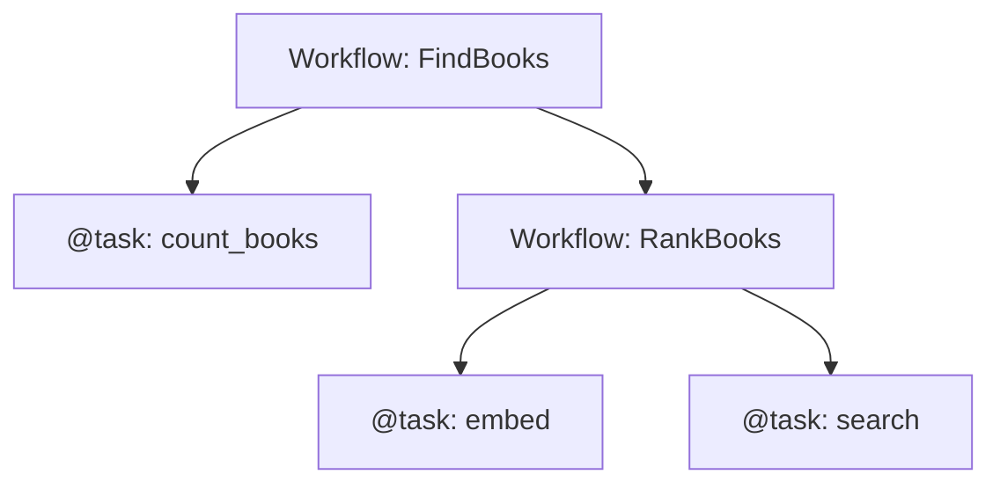

# airglider

airglider is a small tracing library for async Python pipelines. Every unit of work returns the same result envelope, a failure never crashes the caller silently, and a finished run is one tree you can store, summarize and price. It imports nothing from BookShelf, so it can be lifted out as its own package.

## The envelope

Every `@task` and every `Workflow` returns an `OperationResult`:

```
OperationResult
├── id, parent_id, name, description
├── ok              ran to completion
├── timing          start_time, duration
├── input           the call's arguments
├── response        result (the payload) + output_type
├── details         free-text notes
├── token_usage     counts, per-model split, cost_usd
├── runtime_error   type, message, traceback (None when ok)
└── steps           child envelopes, nested the same way
```

Fields and methods: [src/schemas/](src/schemas/README.md).

**How to read one:** `ok` means the step **ran to completion**, not that its result is good. A step that found nothing is `ok=True` with an empty payload. Whoever reads the payload decides whether it is enough.

| What happened | `ok` | `runtime_error` |
|---|---|---|
| Ran, any result (even empty) | `True` | `None` |
| Raised: the step couldn't proceed | `False` | the exception |
| Stopped because a step it needed failed (`unwrap`) | `False` | `StepFailure` |
| Cancelled | `False` | `CancelledError` |

So a *business* failure ("no anchor books to compare") is the producer raising, and lands in `runtime_error` exactly like a crash. There is no third state where `ok=False` carries no reason.

## Workflow and @task

Both produce the same envelope and can call each other in any nesting. The tree builds itself: whatever runs inside a unit of work becomes one of its `steps`.



- **`@task`** wraps one async function. It returns its payload, and the decorator builds the envelope.
- **`Workflow`** is a class for a multi-step process: subclass it, declare an output type and override `run()`. Use it when you want a typed output or somewhere to keep state. A host app usually adds its own base class on top (BookShelf's `AppWorkflow` adds streaming and LLM helpers).
- A plain `async def` is not traced. It runs normally, and if it raises, the nearest traced caller records the error.

## Setup

airglider lives in the BookShelf repo and needs only `pydantic`. Import everything from the package root; [`__init__.py`](__init__.py) is the whole public surface, and `airglider.src.*` is free to move.

```python
from airglider import OperationResult, Workflow, task, add_details
```

```bash
make tests-airglider      # or: poetry run pytest airglider/tests/
```

The tests import only from `airglider`, so they travel with it. To check that airglider still imports nothing from the host, import it with the host packages blocked:

```bash
poetry run python -c "
import sys
class B:
    def find_module(self, name, path=None):
        return self if name.split('.')[0] in {'app','common','config','clients','db','evals'} else None
    def load_module(self, name): raise ImportError(name)
sys.meta_path.insert(0, B()); import airglider; print('ok')"
```

## Usage

```python
@task(description="Counts matching books")
async def count_books(query) -> int:
    ...

class FindBooks(Workflow[BookList]):
    description = "Finds books"

    async def run(self, query):
        # 1. a step we can't continue without: payload or stop
        self.result.count = (await count_books(query)).unwrap()

        # 2. a step whose failure we handle ourselves
        step = await rank_books(query)
        if not step.ok:
            add_details("ranking failed, keeping catalog order")

        self.record.ok = True

record = await FindBooks(BookList)(query)   # always an envelope, never raises
record.result, record.to_summary(), record.flatten()
```

## The rules

**What you get back**

1. **Tracing is opt-in.** A `@task` or `Workflow` gets an envelope and a place in the tree; a plain function does not.
2. **An untraced function that raises fails its caller.** The error lands on the nearest traced caller, with no step showing where it happened.
3. **Calling a traced unit returns an envelope; it never raises.** The exception is `CancelledError`: it is recorded, then re-raised so cancellation still works.
4. **A `@task` returns its payload, never an `OperationResult`.** Returning one raises `TypeError`.
5. **`Workflow` vs `@task` is structure, not permission.** Either may call either, at any depth.

**Who decides `ok`**

6. **`ok` means "ran to completion"**, not "the result is good". An empty result is `ok=True`.
7. **The producer judges completeness; the consumer judges sufficiency.** A caller reads the payload to decide if it is enough, and never asks the producer to encode that in `ok`.
8. **A producer that can't complete raises.** It never sets `ok=False` by hand, which would leave no reason in `runtime_error`.
9. **So `ok=False` always comes with a `runtime_error`.** A `Workflow` sets `self.record.ok = True` at the end of `run()` itself; a `@task` gets it set on return.

**Running a step**

10. **Two verbs.** `await step` returns the envelope and leaves the decision to you. `(await step).unwrap()` returns the payload, or stops the caller.
11. **`unwrap` on a failed step** notes `FAILED STEP: <name>` on the caller and raises `StepFailure`.
12. **A `StepFailure` stops exactly one unit of work.** It is recorded as that unit's error and logged as one warning line without a traceback. It does not escape to the level above: each level decides for itself whether to `unwrap`.
13. **You never attach a step by hand.** `add_step` exists only for an envelope built outside any traced scope, and attaching twice is ignored.

**Writing to your own envelope**

14. **`add_details(...)` writes to the unit currently running**: inside a `@task` body, that task.
15. **`self.add_details` on a `Workflow` always writes to that workflow**, even from inside one of its `@task` methods.
16. **A payload's `token_usage` moves onto the envelope.** If a `@task` returns an object with a `token_usage: TokenUsage` field, the decorator adds it to the envelope and sets the payload's copy to `None`. Type the field `TokenUsage | None`.
17. **`description` is the reader-facing line**, set as a class attribute on a `Workflow` or as `@task(description=...)`. It is not taken from the docstring, which is written for developers.

## Limitations

- **No retries.** A caller retries by constructing a new `Workflow` (instances are single-use) or calling the `@task` again.
- **Errors are untyped.** A business failure and a crash both arrive as a `runtime_error`, so a caller cannot branch on which one it was.
- **Fire-and-forget work is lost.** A `create_task` that outlives its parent attaches to an envelope that has already been reported. Await background work inside the unit that started it.
- **Prices are one provider's snapshot.** See [src/](src/README.md#adding-a-model-price).

How it works inside: [src/](src/README.md). Why it is built this way: [decision 001](../../docs/decisions/001-airglider-step-semantics.md).
