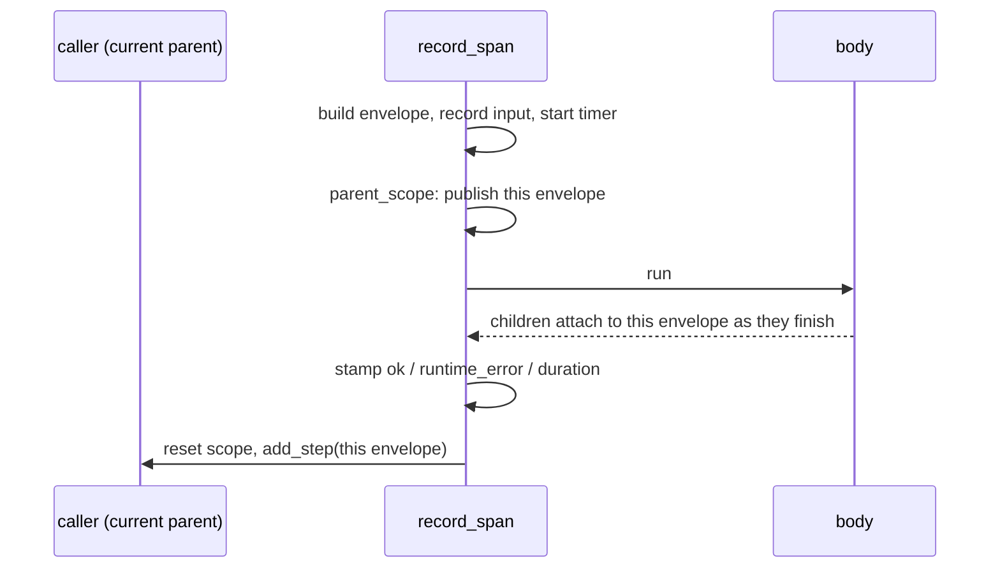

# airglider internals

airglider's `src/` holds the implementation behind the package root. Nothing outside airglider imports from here; the public names are re-exported in [`__init__.py`](../__init__.py).

| Module | What it does |
|---|---|
| [task.py](task.py) | the `@task` decorator |
| [base_glider.py](base_glider.py) | the `Workflow` base class |
| [span.py](span.py) | `record_span`, the recording body both of them share |
| [context.py](context.py) | the ContextVar that tracks the current parent, plus `add_details` |
| [exception.py](exception.py) | `StepFailure` |
| [utils.py](utils.py) | serialization, ids and timestamps, and recording a call's input |
| [config.py](config.py) | the model price table |
| [schemas/](schemas/README.md) | the envelope and its parts |

## How a call is recorded

`@task`'s wrapper and `Workflow.__call__` do the same thing around the body, through `record_span`:

1. **Before the call:** the envelope is built and `input` is recorded, so a crash or cancel still shows the arguments.
2. **During:** `parent_scope` publishes the envelope as the current parent, so anything traced inside attaches to it.
3. **After:** the error and cancel paths stamp `runtime_error`; `duration` is set; then the envelope attaches to the previous parent, which adds its token usage once.

## Nesting

A child can't know its caller, so the caller publishes its envelope in one ContextVar (`CURRENT_PARENT`) and the child attaches itself on the way out. `parent_scope` is the only place that sets it.

- **Concurrency is safe.** A plain `await` shares the caller's context, and `gather`/`create_task` copy it, so siblings each keep the right parent.
- **Attaching happens on exit**, after the child's own steps have rolled up, so token totals are complete when the parent sums them. A cancelled child still attaches, because the attach runs in `finally`.

## Recorded input

`record.input` holds the call's arguments keyed by parameter name (a leading `self`/`cls` is dropped). Each value is recorded whole when it serializes to JSON; otherwise its `to_summary()` is used, and past that `<TypeName>`. Recording never raises: a value that can't be read becomes a missing field, not a failed run.

## Adding a model price

[config.py](config.py) holds USD per 1M tokens for each model, so `TokenUsage` can price itself with no wiring from the host.

1. Add a `ModelPrice(input=..., cached_input=..., output=...)` entry to `MODEL_PRICES`, keyed by the model name. A dated snapshot name (`gpt-4.1-mini-2025-04-14`) falls back to the longest matching key.
2. When you re-verify the rates, bump `PRICES_CHECKED_ON`.

A model with no entry is listed in `unpriced_models` and adds nothing to `cost_usd`, so missing prices show up as unknown spend, never as free.
