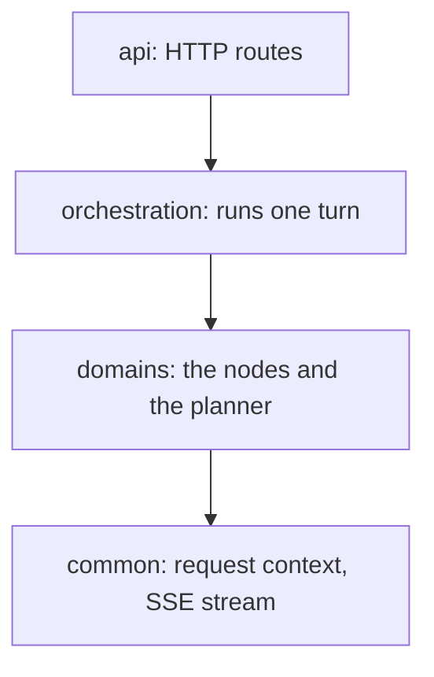

# App

The app (`backend/app/`) is BookShelf's FastAPI application: it takes a chat message over HTTP, plans the work, runs it against the book catalog and streams the reply back. `main.py` builds the app and registers the routes.

## How the folders fit together

A message passes down through four packages, and each imports only from the ones below it:



- **api** receives the message and streams the turn back.
- **orchestration** runs the turn: check the message, decide whether to plan, run the plan, write the reply.
- **domains** holds what the app can do: one node per capability, plus PlanJane, the planner.
- **common** holds what every layer reads.

## Registry

The registry (`registry.py`) is the list of nodes the planner can pick. Each node exports one `NodeSpec`, each domain's `guide.py` lists its specs, and `REGISTRY` is built from those lists alone:

```
NodeSpec   node_type, tier, request, input, output, executor
REGISTRY   spec(node_type) -> NodeSpec        the task runner's lookup
           format_catalog()                   the tool list the planner reads
           NodeTypeEnum                       the names the planner may emit, plus "unknown"
```

A node is live when its spec is in a `guide.py`, and parked when it is not. `make tools-catalog` prints the live catalog. Adding a node: [domains/README.md](domains/README.md#adding-a-node).

## Folders

| Folder | What it is |
|---|---|
| [api/](api/README.md) | The HTTP routes and how they are guarded |
| [orchestration/](orchestration/README.md) | The `Orchestrator` and the stages of a turn: validation, triage, the task runner, the reply |
| [domains/](domains/README.md) | The nodes, their base workflows, and PlanJane |
| [common/](common/README.md) | `RequestContext`, `SSEStream`, the ending tools, field types, prompt loading |

## API endpoints

The routes, their access rules and the wire models: [api/README.md](api/README.md).
