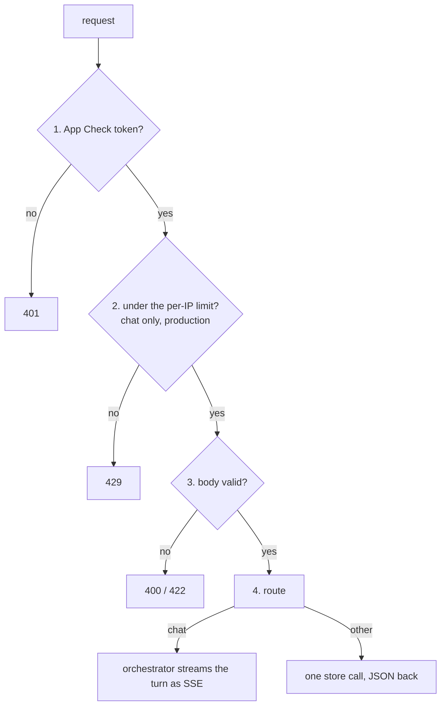

# API

The API (`app/api/`) is BookShelf's HTTP surface: FastAPI routes for health, sessions, the chat and feedback. The routes stay thin. The chat route checks the message and hands the turn to the [orchestrator](../orchestration/README.md), and the other routes are one store call each.

## Flow



1. **App Check:** every route but the health checks needs a valid Firebase App Check token.
2. **Rate limit:** in production, each IP may send `AppConfig.MESSAGES_PER_IP` chat messages per hour.
3. **Body:** the request is validated against its wire model. The chat route also refuses a blank or overlong message.
4. **Route:** the chat route builds a `RequestContext` and streams the orchestrator's events. It touches no database: the token budget is the turn's own work, so a spent session is told in the stream. The other routes read or write through a store on one request-scoped session.

## Routes

| Method | Path | What it does |
|---|---|---|
| GET | `/health`, `/ping` | The process is up |
| GET | `/ready` | The orchestrator is built and the database answers; 503 otherwise |
| POST | `/session/new` | Mints a session id prefixed with its environment (`dev_…`). Writes nothing: the first message creates the session's row |
| POST | `/session/{session_id}/message` | The chat: streams the turn as SSE events. 400 on a blank or overlong message |
| PUT | `/session/{session_id}/message/{chat_id}/feedback` | The chat's thumbs up/down and comments on its own reply, replacing any earlier ones. 404 unless this session's turn is recorded |
| GET | `/chat_runs` | The review queue, least-reviewed first. **Not served in production** |
| PUT | `/feedback/review` | One review per (chat_id, session_id), replaced whole. **Not served in production** |
| GET | `/feedback?chat_id=` | Every review of one turn. **Not served in production** |

The chat's events are listed in [frontend/src/README.md](../../../frontend/src/README.md#sse-events-the-chat-handles).

## Contract

The wire models are in [schemas/external.py](schemas/external.py); import them from `app.api.schemas`.

```
ChatIn        message (emoji stripped)
SessionOut    id, created_at
FeedbackIn    liked, comments: list of ReviewCommentIn (category, message, positive)
ReviewIn      FeedbackIn + chat_id, session_id
BookOut       the book fields a card shows, sent in each book_card event
```

`BookOut` is the only book shape that reaches the browser, so a column added to the internal `Book` stays on the server unless it is added here too.

## Access

- **There is no user auth.** App Check proves a request came from the site, not who sent it: a token copied out of a browser can be replayed until it expires.
- **App Check is enforced only when `APP_FIREBASE_PROJECT_NUMBER` is set**, which the deploy sets and local dev doesn't.
- **The review routes are off in production**, since they read every session's turns and have no admin gate. Review locally with `make dev-neon`, which reads the same database.
- **Feedback on the chat** is checked against the session that produced the turn, so a session rates only its own replies. Development records no turns, so it always 404s under `make dev`; test it with `make local-prod`.
