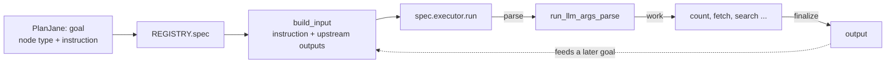
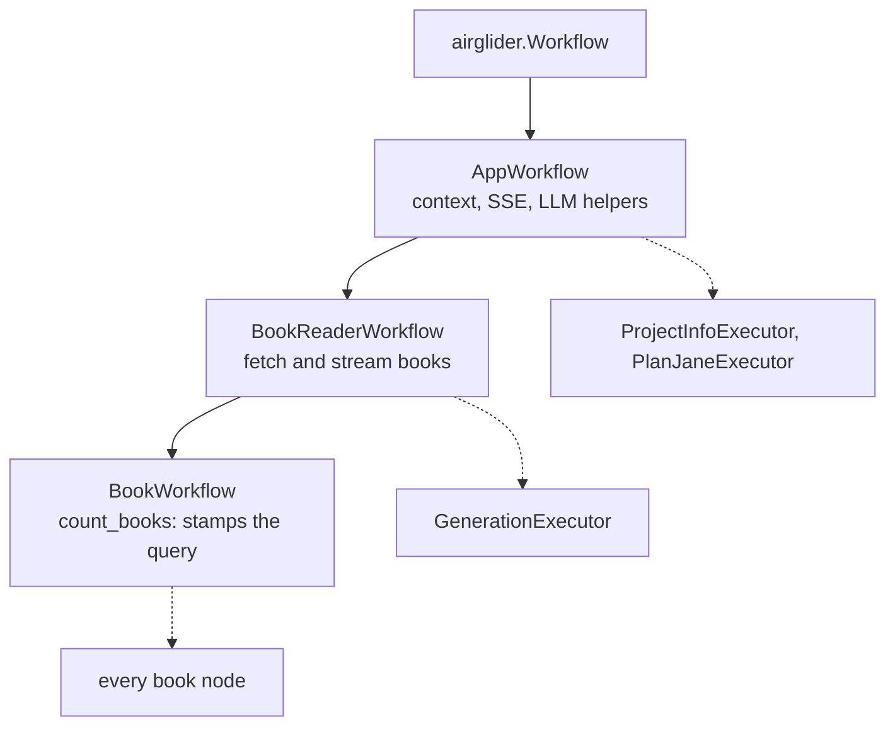
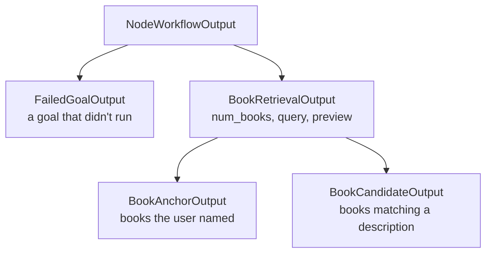
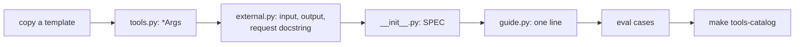

# Domains

The domains package holds everything BookShelf's planner can plan with. Each capability is a **node**, and nodes are grouped into domains: [books/](books/README.md) finds books in the catalog, and [project/](project/README.md) answers questions about BookShelf from its own docs. [planjane/](planjane/README.md), the planner itself, lives here too.

## Flow

How one planned goal reaches a node and back:



1. **Look up:** the task runner finds the goal's `NodeSpec` in the [registry](../README.md#registry). A name with no spec is refused.
2. **Build the input:** `build_input` fills the node's declared input from the planner's instruction and the outputs of the goals it depends on. A required field nothing fills skips the goal.
3. **Run:** the executor parses its arguments from the instruction, does its work, and finalizes its output, which can feed a later goal's input.

## Node spec

Each node is one folder (a slice), and it exports one `NodeSpec` tying its parts together:

```
NodeSpec
├── node_type   the name the planner emits, e.g. "Retrieve_by_Title"
├── tier        RETRIEVAL → COMBINE → ANALYZE, the catalog's sections
├── request     fieldless; its docstring is the planner's catalog entry
├── input       what the task runner hands it (default: just the instruction)
├── output      what the executor fills in
└── executor    the workflow that runs it
```

The slice lays these out as files:

```
books/find_by_title/
├── labels.py     the node's name
├── external.py   request, input, output: what other layers read
├── tools.py      the *Args model its own parse call fills (absent if it parses nothing)
├── executor.py   the workflow
└── __init__.py   SPEC = NodeSpec(...)
```

A domain's `guide.py` lists its specs, and the registry collects them. Removing a spec from `guide.py` parks the node: the code stays, and the planner can no longer pick it. Fields: [node_spec.py](node_spec.py).

Two slices are the templates every node is copied from:

- **[find_by_title/](books/find_by_title/)**, a single-call node: parse args → build the query → count → preview → finalize.
- **[find_similar_books/](books/find_similar_books/)**, a multi-step node: `executor.py` holds the flow, and each satellite module is one LLM call's pure half (rendering, tool model, request builder). Never a `utils.py`.

## Inheritance

Workflows and outputs each form one ladder. A node picks the lowest rung its work needs:





- **`Executor`** marks a workflow the planner can dispatch, one with a `NodeSpec`. Other units of work are named `*Workflow`.
- **The output type is the payload.** `BookAnchorOutput` and `BookCandidateOutput` add no fields: inputs are filled by `isinstance`, so a node taking `list[BookAnchorOutput]` can't be handed a subject search. Write `list[A | B]` to take both but not the base.

Shapes: [base_workflow.py](base_workflow.py), [books/external.py](books/external.py).

## Inputs

Every unit of work takes one argument, `run(node_input)`, of its own `WorkflowInput` subclass ([node_input.py](node_input.py)).

- **Fields are filled by type, never by key.** `X` takes the first match, `X | None` takes it or None, `list[X]` takes all.
- **Default a field when the node has a fallback;** require it only when it can't proceed. A required list needs `min_length`, since an empty list still counts as filled.
- **No pydantic discriminated unions:** `isinstance` against one raises.
- **Services come off the context, not the input:** `sse_stream`, `llm_client` and `session_id` are properties of `RequestContext`. The database is reached through `self.ctx.store(...)`, one block per round trip ([common/README.md](../common/README.md#request-context-schema)).

## Writing an executor

What `ok` means, when to raise and how to run a step are [airglider's rules](../../airglider/README.md#the-rules).

1. **One request, one executor.** New behavior is a new slice, never a flag.
2. **The request declares the capability; `*Args` carries the arguments.** The planner picks a capability and writes an instruction, and never sees `*Args`.
3. **The body runs parse → work → finalize.** `finalize_result()` comes last and states the node's claim. Raise when the node can't proceed; never set `ok=False` by hand.
4. **An empty result is an answer, not a failure.**
5. **Every async call is a step.** Pick the smallest rung: a pure `build_*_request` function → the `run_llm_*` helpers → a `@task` method → a `Workflow` with its own output.
6. **A node hears only its instruction and typed inputs.** No node reads `ctx.user_message`.
7. **Book nodes go counts-first:** build the query → `count_books()` → `fetch_books()` for the preview → hand the query on, not the rows.
8. **Every output field has a default** (the output is built empty), and a workflow instance runs once.
9. **Don't branch on `runtime_error.type`:** a dead end and a crash both land there.

## Adding a node



1. **Copy the matching template** to `<domain>/<node>/`. A book node subclasses `BookWorkflow[TheOutput]`.
2. **Declare the arguments**, if it parses any: `*Args` in `tools.py`, and a module-level `build_arg_parser_request(instruction)` in `executor.py`.
3. **Declare the input** as a `NodeInput` subclass, adding a field per upstream shape it consumes.
4. **Write the request's docstring for the planner.** It is prompt text, with `Purpose:`, `Args:`, `Returns:`, `depends_on:`, `Use when:`, `Do not use:`, `Constraints:` and `Example queries:`. `Returns:` and `depends_on:` name output shapes, which is how the planner knows which nodes feed which.
5. **Subclass the output** from the shape `Returns:` claims.
6. **Export `SPEC`** and add it to the domain's `guide.py`, the only file outside the slice you touch.
7. **Add eval cases** with `expected_nodes` in `backend/evals/planjane/suites/`.

`make tools-catalog` then confirms the node reached the planner's catalog, and flags a missing executor or docstring section.
