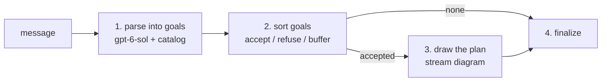

# PlanJane

PlanJane is BookShelf's planner: it turns a user message into a plan, a short list of goals where each names one capability (node), the instruction that node runs on, and the goals it waits for. It sits one level above plain tool calling. Instead of the model calling tools one at a time, PlanJane makes one call that lays out the whole job first, and the task runner then executes it.

That split keeps nodes simple to add. A new node is a request schema with a docstring, registered in its domain's `guide.py`; PlanJane reads the live catalog on every call, so it can plan with the node without any change here. The plan is also drawn as a diagram the user sees before anything runs, which gives a high-level view of what the system decided to do.

What decides *whether* to plan at all (cached plans, small talk, unclear or misused messages, project questions) is triage, one layer up in `app/orchestration/triage/`.

## Flow



1. **Parse** — one LLM call reads the message with the full tool catalog in its prompt and fills `GoalParseRequest`: the goals, plus any parts of the message that are out of scope. A parse with neither fails the node.
2. **Sort** — each goal is refused when its confidence is under 0.5 or its node type isn't registered (`unknown` lets the model decline rather than guess). The rest are accepted, up to 10; any beyond that are buffered.
3. **Draw** — the accepted goals become a Mermaid flowchart, streamed to the chat and kept on the output.
4. **Finalize** — the node is ok when at least one goal was accepted.

A filled `GoalParseRequest` can also be handed in directly, which skips step 1 and runs the same sorting.

### Writing an instruction

The instruction is a node's whole brief: a node never sees the user's message. So each instruction carries every title, name and number it needs, does no other goal's work, and resolves every pronoun ("books like Dune", never "books like it"). It is capped at 300 characters; longer is cut off.

## Contract

| | Shape | Notes |
|---|---|---|
| Input | `NodeInput` or `ParsedInput[GoalParseRequest]` | The message to plan, or goals already parsed |
| Tool | `GoalParseRequest` | What the LLM fills: `system_goals`, `out_of_scope`, `reasoning` |
| Output | `PlanJaneOutput` | The goals, sorted, plus the diagram |

```
PlanJaneOutput     accepted / refused / buffered goals, out_of_scope, diagram
└── SystemGoal     one node to run, its instruction, the goal ids it waits for
```

`PlanJaneOutput.execution_order()` layers the accepted goals by dependency: goals in one layer can run concurrently. Goals that can never run (a cycle, or a dependency that was refused) come back as `unreachable` rather than being dropped.

When nothing is accepted but part of the message is out of scope, the turn still gets a reply saying BookShelf doesn't do that part.

Fields and docstrings: [external.py](external.py) and [tools.py](tools.py). Import from the `planjane` package root.

## The diagram: `dial/`

[dial/](dial/) draws the plan. `mermaid.py` decides what each box says and turns `depends_on` into arrows; `format.py` turns boxes into the Mermaid string. `dial/` imports nothing from the rest of the app (only `airglider`), so it can move with PlanJane if the planner becomes its own service.

## Model and cost

The planner runs on `gpt-6-sol` at reasoning effort `none`. Accuracy outranks cost in that choice: it is the one call that sees every capability, and a wrong plan costs more than the call does.

Its prompt carries the whole tool catalog on every request, byte-identical each time, so it is almost always served from OpenAI's prompt cache at a tenth of the price. The current plan cap at 10 tasks. `make tools-catalog` shows the catalog's current size and cost.
