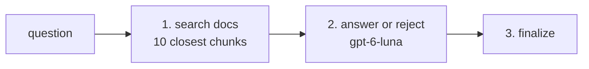

# Retrieve_Project_Info

`Retrieve_Project_Info` is the BookShelf node that answers questions about BookShelf itself — "what tech stack does this use", "what is PlanJane", "where's the GitHub repo". It searches the project's own documentation for the closest passages and answers from those alone. When they don't answer the question, it says no rather than guessing.

Two callers reach it. Triage's router runs it directly for most project questions, so they never reach the planner. The planner can also pick it, which covers project questions the router passed on.

## Flow

1. **Search** — the instruction goes, as written, to an OpenAI vector store over BookShelf's docs, which returns the 10 closest chunks. No chunks fails the node.
2. **Answer or reject** — one LLM call reads the question and the chunks and fills `ProjectDocsAnswer`: first whether the chunks actually state the answer, then the answer and the docs it rests on.
3. **Finalize** — the node is ok only when there is an answer.

There is no argument parse: the instruction already is the question.

### Layout

- **[executor.py](executor.py)** is the flow: `run` plus the search step.
- **[answer_from_docs.py](answer_from_docs.py)** is the answer call's pure half — rendering the chunks, the `ProjectDocsAnswer` tool and the request builder. Nothing in it runs.

## Tools

- **`ProjectInfoArgs`** ([tools.py](tools.py)) — what triage's router fills to ask a project question: one field, `question`, in the user's words. The node itself never ships it.
- **`ProjectDocsAnswer`** — the answer call's schema, never seen by the planner: `supported`, then `sources` and `answer`, both empty when the chunks don't answer.

## Contract

| | Shape | Notes |
|---|---|---|
| Request | `ProjectInfoRequest` | No fields — its docstring is what the planner reads to choose this node |
| Input | `ProjectInfoInput` | The question only; takes no upstream output |
| Output | `ProjectInfoOutput` (a `NodeWorkflowOutput`) | `question`, `answer`, `sources` |

The output is **not book-shaped**, so no book node can depend on it. The reply stage writes the answer into prose and shows its sources in the chat's "Sources" popup.

Fields and docstrings: [external.py](external.py).

## Errors

- **A rejection fails the node.** When the chunks are only near the question, `answer` stays empty and the node finishes not ok. From triage, that sends the whole message to the planner.
- **The node fails** when no vector store is configured (`OPENAI_VECTOR_STORE_ID`) or the search returns nothing.

## Limitations

- **One question per call.** The search takes the instruction as one query; it doesn't split a long or multi-part question into smaller searches, so a question touching several topics gets the chunks closest to the whole.
- **Docs only.** The store holds the project's READMEs and `docs/`, not source code, so a question only the code answers is rejected.
