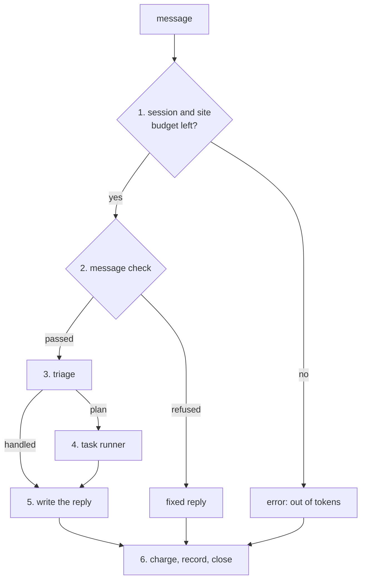

# Orchestration

Orchestration runs one BookShelf chat turn, from the user's message to the streamed reply. The `Orchestrator` owns the turn's transport (the SSE stream, timeouts, cancellation, charging and recording), and hands the work itself to a chain of stages, each a workflow with its own step in the turn's trace.

## Flow



1. **Budget:** read the session's remaining tokens; this also creates its row on a first message. In production, the site's daily spend is checked too. A spent budget ends the turn with an error.
2. **Message check:** [validation](validation/README.md) refuses misuse, harmful content and gibberish with a fixed reply. Nothing else reads the message until it passes.
3. **Triage:** [triage](triage/README.md) replays a cached plan, replies directly, refuses, looks up project facts, or calls the planner.
4. **Tasks:** the [task runner](task_runner.py) runs the plan's goals in dependency order, each in its own UI section.
5. **Reply:** [write_reply](write_reply/README.md) writes the answer from the project facts, every goal's result, and the parts the planner set aside as out of scope.
6. **Finalize:** charge the turn, record it, close the stream. This always runs, whatever happened above.

## Stages

| Stage | Decides | Lives in |
|---|---|---|
| Message check | may the message go any further | [validation/](validation/README.md) |
| Triage | does the message need a plan | [triage/](triage/README.md) |
| Task runner | runs the plan; one `TaskResult` per goal | [task_runner.py](task_runner.py) |
| Reply | the answer the user reads | [write_reply/](write_reply/README.md) |
| Budget | may the session spend, and what the turn cost | [token_budget.py](token_budget.py) |
| Recorder | where the finished turn is kept | [run_recorder.py](run_recorder.py) |

The orchestrator is the only place the stages are wired together. The task runner takes a plan and nothing else, so it never learns a triage layer exists.

## Contract

| | Shape | Notes |
|---|---|---|
| Input | `RequestContext` | the message, session id and services, built by the chat route |
| Output | the SSE stream | events are listed in [frontend/src/README.md](../../../frontend/src/README.md) |
| Record | `OperationResult` | the turn's root envelope, with each stage's envelope as a step |

```
orchestrator_<chat_id>     the root: ok, duration and tokens for the whole turn
├── start_session_turn
├── read_site_spend        production only
├── validate_user_message
├── TriageWorkflow         └── PlanJane, when it planned
├── TaskRunnerWorkflow     └── one step per goal
└── GenerationExecutor
```

The stream opens with `chat.id`, so the client can rate a turn that later fails, and ends with `complete`, which carries the flattened trace for the reply's log button.

## Recording

Each turn goes to one sink, chosen by environment:

| Environment | Sink |
|---|---|
| production | one `chat_runs` row: the root's stats, then one JSONB envelope each for triage, tasks and the reply |
| development | JSON files under `logs/<chat_id>/`: the trace, the conversation, the writer and its report |
| test | nothing |

The debit and the record each open their own database session, because they run after the request has returned.

## Failures

- **Refusals are handled turns:** a failed message check and triage's own refusals send a fixed reply, then `complete`. A spent budget sends an error event instead.
- **A stage that fails** sends a generic error event. A failed reply sends its own "couldn't finish writing" error after the task sections.
- **A check with no verdict stops the turn:** the budget read and the message check fail closed, unlike triage, which fails open to the planner.
- **Timeouts:** triage, the task runner and the reply each run under a 120-second ceiling.
- **Disconnects:** finalizing is shielded, so a turn whose client leaves mid-turn still has its debit and record written, and its stream closed.
- **Finalizing never raises:** each step (debit, record, close) has its own timeout and log line, and one failing never stops the next.
