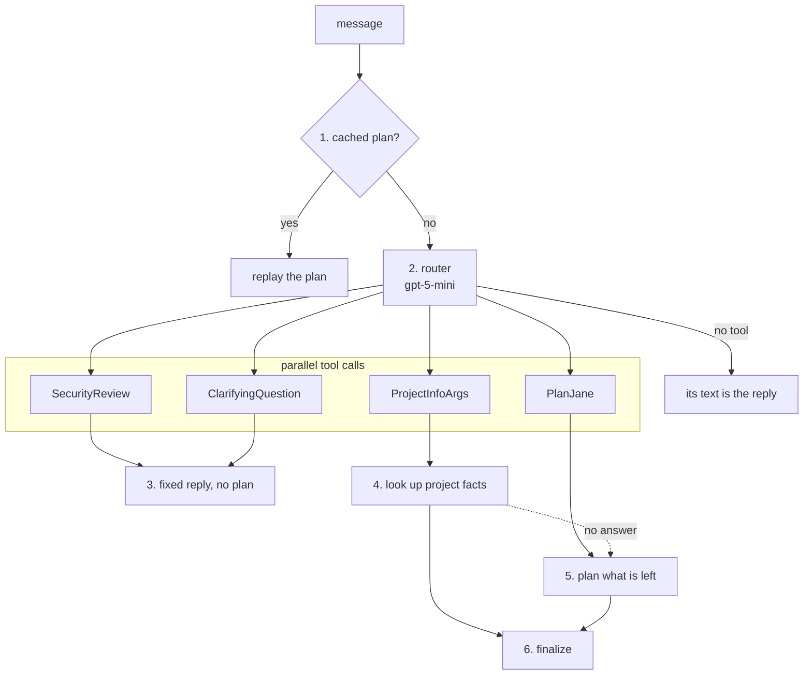

# Triage

Triage is the first step of every BookShelf turn after the message check: it decides whether the message gets planned at all. Most messages go on to PlanJane, the planner. Triage handles the rest itself: a cached plan, small talk, an unclear message, misuse, or a question about BookShelf. It is cheap on purpose, because it runs ahead of every planned turn and only has to spot what the planner shouldn't see.

Triage isn't a node. The planner can never pick it, and its only domain knowledge is which planner to call. It runs as its own workflow, not as part of the orchestrator, so each of its outcomes, a cache hit or a refusal included, is a step in the turn's trace.

## Flow



1. **Cache:** a message with a recorded plan replays it, with no LLM call.
2. **Route:** one gpt-5-mini call is offered four tools and may call several at once. When it calls none, its text goes straight to the user, which the prompt allows only for small talk.
3. **End early:** `SecurityReview` or `ClarifyingQuestion` ends the turn with its own reply, whatever else was called. Misuse anywhere in a message wins.
4. **Project facts:** `ProjectInfoArgs` is answered right here by running the `Retrieve_Project_Info` node, with no plan. It is a [promoted tool](#promoted-tools).
5. **Plan:** `PlanJane` hands the message to the planner. When step 4 answered part of it, the planner gets only what is left.
6. **Finalize:** see [Failures](#failures).

A turn that ends without a plan is still a handled turn: the orchestrator skips the task runner, and writes the reply from the project facts when there are any.

## Tools

| Tool | Called for | Lives in |
|---|---|---|
| `PlanJane` | everything else: book asks, questions about books or how BookShelf works, off-topic asks. The default | [tools.py](tools.py) |
| `ProjectInfoArgs` | a fact about BookShelf: what it is, its stack, PlanJane or Airglider, what it can't do, its links | [find_project_info/tools.py](../../domains/project/find_project_info/tools.py) |
| `ClarifyingQuestion` | a message that can't be acted on: a follow-up with no earlier turn, a misspelling with no obvious fix, an ambiguous ask, an unreadable one | [app/common/tools.py](../../common/tools.py) |
| `SecurityReview` | misuse: other users' data, the system prompt, SQL or any other code | [app/common/tools.py](../../common/tools.py) |

Only `ProjectInfoArgs` and `PlanJane` are called together. Then `PlanJane.message` carries the rest of the message in the user's own words, and that is what the planner reads. Otherwise the planner reads the whole message.

Clarify what is unclear, not what is unsupported or vague: "recommend me a book" and "what's the weather?" are clear, so they go to the planner, which decides what it can do. Conversations are single-turn, so a follow-up that points at an earlier turn is always a clarification.

The routing rules, with examples, are the prompt: [prompts/route_query.txt](prompts/route_query.txt).

### Promoted tools

A promoted tool is a planner node that the router is also offered, so a common ask skips the planner. Like the [cache](#cache), it is an optimization: it saves a planner call and its whole tool catalog.

`ProjectInfoArgs` is the only one. It is the `Retrieve_Project_Info` node's own parse schema, and triage runs that node's executor directly. The node stays registered, so the planner can still reach the same facts. That covers a failed lookup, which sends the whole message on, and a router call that fails.

To promote another node, it must be cheap, be answerable on its own, and come up often enough to be worth a router tool.

## Contract

| | Shape | Notes |
|---|---|---|
| Input | `NodeInput` | `instruction` is the user's checked message |
| Output | `TriageOutput` | the plan, and the project facts when they were looked up |

```
TriageOutput
├── parse_result   PlanJaneOutput, when the planner ran or a plan was replayed
└── project_info   ProjectInfoOutput, when the router looked facts up
```

Fields: [external.py](external.py). Import from the `triage` package root.

## Failures

Triage **fails open**: when it can't tell where a message goes, the planner decides.

- **The router fails:** it errors, returns neither a tool nor text, or makes a parallel call that doesn't fit its schema. The whole message goes to the planner.
- **The project lookup fails, or the docs don't answer it:** the facts are dropped and the whole message goes to the planner.
- **The planner errors:** triage sends "I couldn't understand your request. Please try again." and is not ok, so the orchestrator ends the turn with its own error too.
- **The planner accepts no goals:** triage is not ok and the turn ends in the orchestrator's error, unless there is still something to reply from. That means project facts, or parts of the message the planner marked out of scope, which the reply says BookShelf doesn't do.

## Cache

[cache.py](cache.py) maps a message to a recorded `PlanJaneOutput` in [files/](files/). Matching is on the exact text. A hit replays the plan in every environment, production included, and tells the user it was cached. An entry whose file is missing or no longer validates falls through to the planner.

## Evals

`make eval-routing` grades the router alone, with no backend or database: see [evals/README.md](../../../evals/README.md#triage--the-router-triage).
