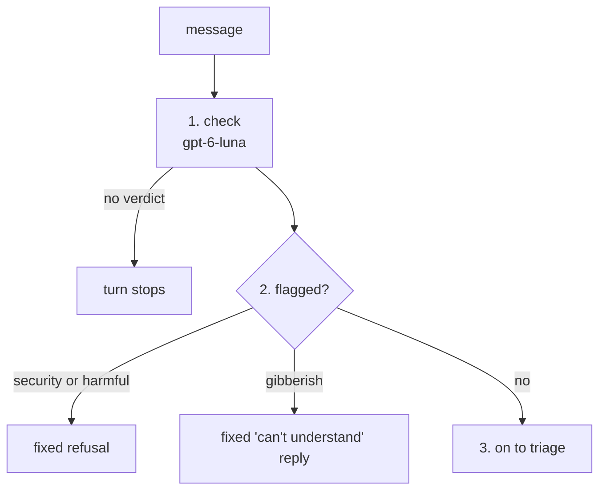

# Validation

Validation is the message check, the first thing a BookShelf turn does with the user's message. One cheap LLM call decides whether the message may go any further, and nothing else in the app reads the message until it passes. It looks for three things only: a security threat (phishing, malware, credential harvesting), harmful content (hate, threats, violence, self-harm, dangerous instructions), and gibberish.

Everything else is left to later steps. A message in another language passes, and so does code or a prompt injection, which triage's `SecurityReview` turns away. See [triage](../triage/README.md).

## Flow

1. **Check:** one gpt-6-luna call at reasoning effort `none` fills `UserMsgValidation`. It writes its `reasoning` first, then the three flags.
2. **Refuse:** `refusal_for` picks a fixed reply. Security and harmful outrank gibberish. The turn ends as ok, like any other handled turn.
3. **Pass:** the message is marked as passed and handed to triage.

It runs as a `@task`, not a workflow, so the orchestrator attaches it as a step on the turn's trace, with its spend.

## Contract

| | Shape | Notes |
|---|---|---|
| Input | `RequestContext` | reads the turn's `user_message` |
| Output | `UserMsgValidation` | `reasoning`, then `security_issue`, `harmful_content`, `gibberish_or_incoherent` |

The orchestrator records the outcome on the message as `pass_validation`. A `UserMessage` marked as failed refuses to be sent to any LLM.

Fields: [tools.py](tools.py). Import from the `validation` package root.

## Failures

Validation **fails closed**, unlike triage: when the model returns no verdict, the turn stops with the orchestrator's error rather than letting an unchecked message through.

The refusals are fixed text, never the model's words, so nothing a prompt injection steers reaches the user.

## Evals

`make eval-validation` grades the check alone, with no backend or database: see [evals/README.md](../../../evals/README.md#validation--the-message-check-validation).
