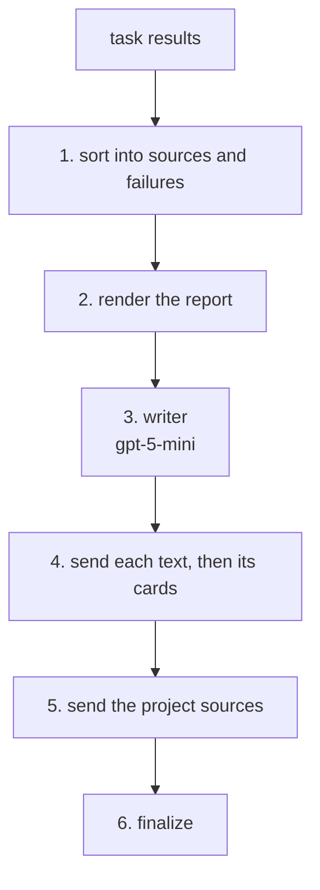

# Write Reply

Write_reply is the stage that writes BookShelf's reply to every turn: it reads everything triage and the plan produced and answers the user in prose, with book cards placed after the text that talks about them. It is the last step of a turn, and the only one whose words the user reads as the answer.

It isn't a node. The planner can never pick it; the orchestrator runs it once per turn, after the task runner. So it has no goal: the user's own message is its brief, and it writes from every result, not one chain's. It fetches nothing, since each node already kept the books it previewed.

## Flow



1. **Sort:** books and project facts are sources; a `FailedGoalOutput` is a failure. Anything else is dropped.
2. **Render:** the results become one report, sources first, a section per goal. Each book gets a handle (`1.2`: section 1, book 2) instead of an identifier.
3. **Write:** one gpt-5-mini call reads the report and the user's message, and fills `GenerationResult`: text blocks, each followed by the handles of the books it talks about.
4. **Send:** each text streams as characters, then its cards. A book is shown once per reply, and a handle that isn't in the report is dropped.
5. **Sources:** the docs any project facts came from go to the browser, for the chat's Sources button.
6. **Finalize:** see [Failures](#failures).

## What it writes from

The orchestrator hands over one list of `TaskResult`s:
- triage's project facts, when it looked any up;
- every goal the plan ran, including a `FailedGoalOutput` for each one that failed or was skipped;
- the parts of the message the planner set aside as out of scope, also as failures.

The writer reads it as one report. A sketch of a two-goal turn:

```
What I found:

[1] <goal instruction>
<info>
found N book(s)
arguments: {...}
took ...s, ... tokens (... in, ... out)
sql: SELECT ...
</info>
<books>
- [1.1] <title> — <authors>, <year>, <pages>, <rating>
  <description>
</books>

[2] <goal instruction>
<info>
could not be completed — <reason>
</info>
```

- `<info>` says how the goal ended and how it was done. The prompt says to read it and never repeat it.
- `<books>` lists up to four books, with no ISBN.
- A project lookup gets a `<project>` block with its answer and sources instead. When a question about BookShelf goes unanswered, the prompt has the writer say so and link the GitHub repository, the one link it may give that isn't in the report.

Each section is capped, so a long one can't push the failures, which come last, out of the report. The writer's rules are the prompt: [prompts/reply.txt](prompts/reply.txt).

## Contract

| | Shape | Notes |
|---|---|---|
| Input | `RecommendationsInput` | `results`: the list above, in run order |
| Writer's tool | `GenerationResult` | the reply as blocks |
| Output | `RecommendationsOutput` | the blocks, the report, and how many cards were shown |

```
GenerationResult
└── blocks   list of TextBlock | SourceBlock
    ├── TextBlock     type "text", text: markdown the user reads
    └── SourceBlock   type "source", refs: handles like "1.1"

RecommendationsOutput
├── render_evidence   the report the writer read
├── blocks            the reply, as sent
└── num_books_shown
```

Fields: [external.py](external.py). Import from the `write_reply` package root.

## Failures

- **ok** means the turn was answered, not that books were found. A reply over empty searches, or over failures alone, is still a correct answer.
- **Not ok** means a reply with no words, or a writer call that failed. The orchestrator then sends its own error after the task sections, so the stream never ends without a reason.
- **Nothing to write from** never reaches this stage: the orchestrator skips it, and an empty list raises as a caller bug.
- **A failed goal's error** reaches the writer as its message only, never its type or traceback. The prompt turns it into a plain cause ("that isn't something I can do yet").
