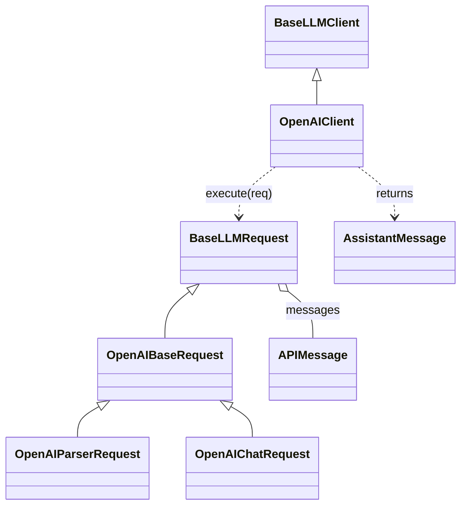

# clients

`clients` is BookShelf's wrapper around the OpenAI API: request models that build and check a payload, message models that render themselves into it, and one `OpenAIClient` that sends it. It does no tracing. A client method does its I/O and returns a payload or raises; the app turns a call into a recorded step on `AppWorkflow` (`llm_execute`, `get_embeddings`, `execute_tool_call`).

Import from the package root: `from clients import OpenAIClient, OpenAIParserRequest, UserMessage`.

## How the pieces fit



- **`BaseLLMClient` / `BaseLLMRequest`** are the provider-neutral interfaces: `execute`, `token_count`, `close` on the client; `prompt`, `messages`, `model` and `to_payload()` on the request.
- **`OpenAIClient`** implements them, plus `get_embeddings` and `search_vector_store`. One instance is built per app (`AppContext`) and shared by every request.
- **`APIMessage`** is a union of `SystemMessage`, `UserMessage`, `AssistantMessage` and `ToolMessage`, picked by `role`.

## Request types

| Request | Sends | Returns |
|---|---|---|
| `OpenAIBaseRequest` | the prompt and messages | an `AssistantMessage` with text |
| `OpenAIParserRequest` | the same, plus `tool_models` as function tools | tool calls, parsed into those models. One model pins the call to it; several let the model call any of them, in parallel, or answer in text |
| `OpenAIChatRequest` | the same as the base | text, streamed to the browser as it arrives. Requires `sse_stream` |

Every request is checked when it is built, so a bad one fails at the call site rather than at the API:

- **Model family.** A reasoning model (anything not `gpt-4*`) takes `reasoning_effort`; the others take `temperature`, `top_p` and `seed`. Setting one the model ignores raises.
- **Tool linkage.** Every assistant tool call needs a `ToolMessage` reply, and every `ToolMessage` needs its call.
- **Size.** `max_completion_tokens` may be lowered, never raised past `OpenAIConstants.MAX_DEFAULT_COMPLETION`. `execute` also refuses a payload over `MAX_INPUT_TOKENS`, counting messages and tool schemas together.

A completion cut off by `max_completion_tokens` raises, rather than coming back as an empty tool call.

## Concurrency

Each `OpenAIClient` holds one `asyncio.Semaphore` sized by `OPENAI_MAX_CONCURRENCY`. Every API call (completion, embeddings, vector-store search) waits on it, so callers can fire as many calls as they like with `asyncio.gather` and the client keeps no more than that many in flight.

## Usage

**Messages render themselves.** The request turns `prompt` into the leading system message, then calls each message's `to_openai_dict()`. A `ToolMessage` serializes non-string content to JSON. A `UserMessage` marked `pass_validation=False` (the message check refused it) raises instead of rendering, so a refused message can't reach a model.

**Inside a workflow**, build the request with a module-level `build_*_request` function and run it through `AppWorkflow.run_llm_args_parse` or `run_llm_tool_calls`, which record the step and its token usage:

```python
def build_route_request(query: str) -> OpenAIParserRequest:
    return OpenAIParserRequest(
        prompt=load_prompt(prompt_path=ROUTE_PROMPT_PATH),
        prompt_path=ROUTE_PROMPT_PATH,
        model="gpt-5-mini",
        reasoning_effort="low",
        messages=[UserMessage(content=query)],
        tool_models=[PlanJane, SecurityReview, ClarifyingQuestion, ProjectInfoArgs],
    )
```

**On its own**, as the evals do, build a client and close it when done. Nothing is recorded:

```python
client = OpenAIClient(settings.openai)
try:
    msg = await client.execute(build_route_request("books like Dune"))
    print(msg.tool_calls, msg.token_usage.cost_usd)
finally:
    await client.close()
```

`prompt` is excluded from serialization, so a recorded request shows `prompt_path` instead of the full text.
