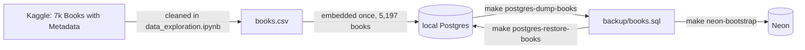

# data

`data/` holds BookShelf's book catalog outside the database: the source CSV, the dump the `books` table is seeded from, and the notebooks that explored both. The app reads none of it at runtime.

## Where the books come from

- **Source:** [7k Books with Metadata](https://www.kaggle.com/datasets/dylanjcastillo/7k-books-with-metadata) on Kaggle. The cleanup follows [this walkthrough](https://www.youtube.com/watch?v=Q7mS1VHm3Yw): it drops books with missing fields and descriptions under 25 words, and joins title and subtitle.
- **`backup/books.sql` is the seed.** It is the `books` table, data only, with its 1024-dim embeddings. `books.csv` has no vectors, so rebuilding from it means paying to embed every book again.

## Files

| File | What it is | In git |
|---|---|---|
| `books.csv` | the cleaned Kaggle export | no (`*.csv`) |
| `backup/books.sql` | the `books` table dump, ~70 MB | no (`data/backup/`) |
| `data_exploration.ipynb` | the original cleanup, run on Colab against the Kaggle download | yes |
| `data_exploration_2.ipynb` | queries against the live database, plus model spend from `chat_runs` | yes |
| `exploration_notes.md` | findings logged by `note(...)` in `data_exploration_2.ipynb` | yes |

## Seeding a database

**Local:** `make postgres-start` on an empty volume runs `db/init/`, then `make postgres-restore-books` loads the dump and rebuilds the ivfflat index.

**Neon:** `make neon-bootstrap`; see [db/](../db/README.md#neon).

Both need `backup/books.sql` on disk. A fresh clone does not have it.
