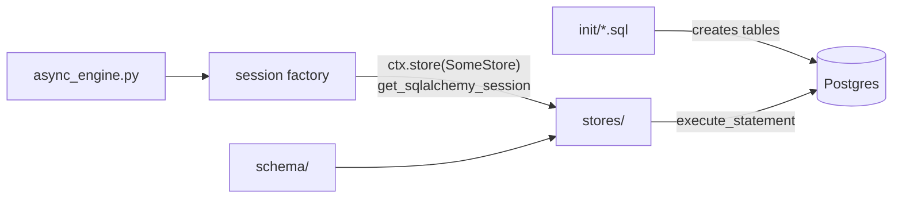

# db

`db` is BookShelf's Postgres layer: one async SQLAlchemy engine, the schema as raw SQL plus its ORM models, and the stores every query goes through. Postgres runs locally in Docker and on Neon in production, with `pgvector` for embeddings and `pg_trgm` for fuzzy author matching.



| Folder / file | What it holds |
|---|---|
| `async_engine.py` | the engine, its session factory and `check_connection`; built once by `AppContext` |
| `init/` | the schema as SQL, run in name order: extensions, tables, indexes |
| [`schema/`](schema/README.md) | the ORM models and the filter models a search takes |
| [`stores/`](stores/README.md) | one store per table, plus the `books` query builders |

## The engine

`AppConfig.DATABASE_TIMEOUT` is enforced here, in four layers, each set above the one it backs up:

1. **`statement_timeout`**: Postgres cancels its own query, and the connection stays usable. It surfaces as a `DBAPIError` with sqlstate 57014. It is a startup parameter, so it needs Neon's direct host; the `-pooler` host rejects it.
2. **asyncpg `command_timeout`** (2s higher): the client-side backstop for a connection that never reaches the server.
3. **`pool_timeout`**: the wait for a free connection.
4. **asyncpg connect `timeout`**: the wait to open one. Without it, asyncpg waits 60s, which is what `pool_pre_ping` falls back to after dropping a connection Neon suspended.

## Where the schema comes from

`init/` is never read by the app and is not in the image (`.dockerignore`, `.gcloudignore`). `Base.metadata.create_all` is not used, so a model's `index=True` does nothing.

- **Locally**, `docker-compose.yml` mounts `init/` into `/docker-entrypoint-initdb.d/`, which runs it only when the container starts on an empty volume.
- **On Neon**, `make neon-bootstrap` applies it once, loading the books between the tables and the indexes.

So a change to `init/` never reaches an existing database. Apply the same DDL to each one by hand: `make postgres-query FILE=<file>` locally, `make neon-cli ARGS='-f <file>'` on Neon.

## Commands

```bash
make postgres-start          # Docker Compose Postgres; runs init/ on an empty volume
make postgres-restore-books  # seed books from data/backup/books.sql (see data/README.md)
make postgres-cli            # psql shell
make postgres-stop

make dev-neon                # make dev against Neon (config/.env.deployment's POSTGRES_*)
make local-prod-neon         # the same, as APP_ENVIRONMENT=production
make neon-cli                # psql shell on Neon
make neon-bootstrap          # seed an EMPTY Neon database from init/ + data/backup/books.sql
```

## Neon

The Neon targets go through `neon psql`, so link the CLI once per machine:

```bash
neon auth
neon link --project-id dry-frog-27239435 --branch production --no-env-pull --no-config -y
```

`--no-env-pull` matters: a pull writes `DATABASE_URL` into `config/.env`, which the app never reads. The app's own Neon settings are the `POSTGRES_*` lines of `config/.env.deployment`.

**Bootstrapping an empty database** (`make neon-bootstrap`, about 1.5 minutes) runs extensions, tables, the books, then the indexes, in that order. The similarity index must come last, because it is built from the rows present. Check it:

```bash
make neon-cli ARGS='-c "SELECT extname, extversion FROM pg_extension;"'   # vector, pg_trgm
make neon-cli ARGS='-c "SELECT count(*), count(embedding) FROM books;"'   # 5197 | 5197
make dev-neon   # then: curl localhost:8000/ready → 200
```

Use plain SQL rather than `\d` meta-commands: local psql 16 warns against the version 18 server.

**Trying a schema change on Neon:** apply it to a branch before `production`.

1. `neon branches create --name mig-<topic>` makes an instant copy of production, books included.
2. Point `POSTGRES_HOST` in `config/.env.deployment` at the branch, apply the DDL with `make neon-cli ARGS='-f <file>'`, and try it with `make dev-neon`.
3. Apply it to `production`, and point the host back before any `make deploy`.

Why it is set up this way: [database strategy](../../docs/strategies/database.md).
