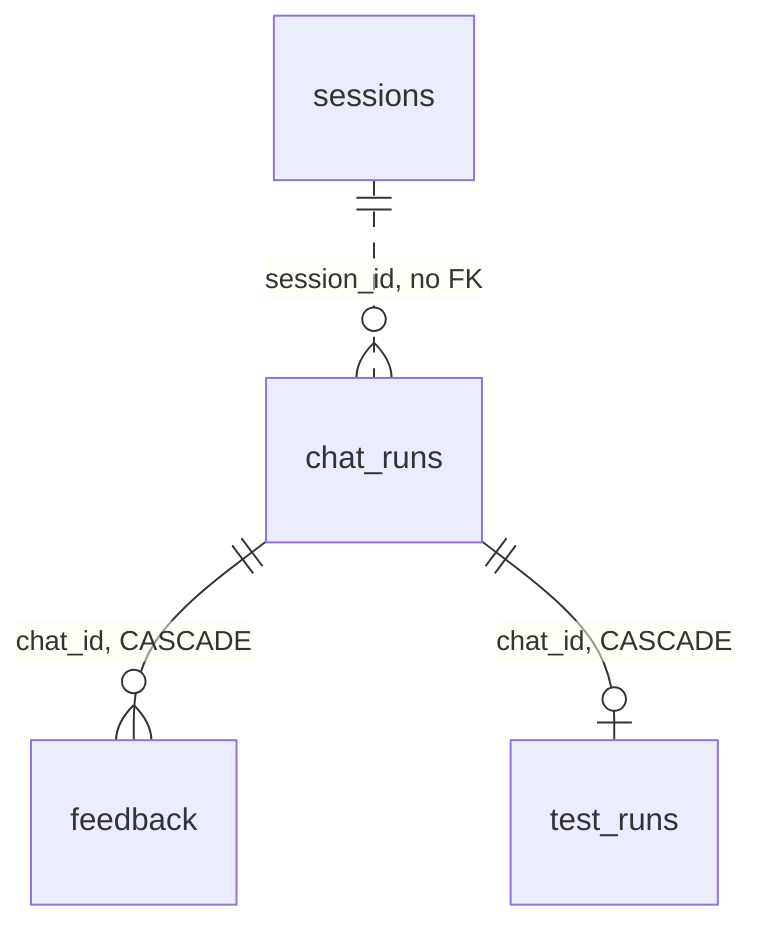

# db/schema

`db.schema` is the Python side of BookShelf's tables: one SQLAlchemy model per table in `models.py`, and in `filter_schemas.py` the value vocabularies and bounds that book searches take. The tables themselves are created by `db/init/`, not by these models.

Import from the package root: `from db.schema import BookModel, BookMetadataFilter`.

## Tables

| Table | Model | What a row is |
|---|---|---|
| `books` | `BookModel` | one book: the catalog columns plus a 1024-dim `embedding` of its description |
| `sessions` | `SessionModel` | one chat session that has sent a message, with its `remaining_tokens` |
| `chat_runs` | `ChatRunModel` | one chat turn: the user message, promoted stats, and one JSONB envelope per layer (`planner`, `tasks`, `writer`) |
| `feedback` | `FeedbackModel` | one review of a run per reviewing session: `liked` and/or a list of comments |
| `test_runs` | `TestRunModel` | which eval suite case produced a run |

- **`sessions`** is created on a session's first message; `POST /session/new` writes nothing. It is debited once per turn, after the turn runs, so the last turn can push it below zero. That is why there is no `CHECK (remaining_tokens >= 0)` and no default (the starting budget is `settings.app.SESSION_TOKEN_BUDGET`, `APP_SESSION_TOKEN_BUDGET`).
- **`chat_runs.writer`** is the reply stage's envelope, and the only stored copy of the turn's prose.
- **`feedback`** has one row per `(chat_id, session_id)`, the upsert target. On the review page the session is the reviewer's; in the chat it is the session that produced the run. A run's review count is counted from these rows, never stored.
- **Deleting a `chat_runs` row** takes its `feedback` and `test_runs` rows with it.

## The books columns

- **`genre`** holds four values that combine fiction-ness and audience ("Children's Fiction"). `GenreEnum` and `AudienceEnum` are both resolved against it.
- **`is_children` is NULL on every row**, so `BookMetadataFilter.is_children` matches nothing. It is kept by owner decision; audience goes through `AudienceEnum`.
- **`books_search_idx`** in `db/init/02_indexes.sql` is a GIN index over the same `to_tsvector(...)` expression that `search_document()` in `stores/book_store.py` builds. Postgres matches expression indexes structurally, so the two must stay character-identical, with no bind parameters in the Python. Otherwise the index silently stops being used (~5ms becomes ~520ms). `tests/unit/db/stores/test_lexical_query.py` checks both.

## Filter models

`BookMetadataFilter` is the bounds a numeric search takes (pages, rating, ratings count, year). Ranges are inclusive, and an inverted range raises. Its field descriptions hold the calibration for vague words ("well rated" means `min_rating=4.0`), so that every parser of bounds reads them the same way.

These docstrings and descriptions ship to the LLM inside tool schemas, so editing one changes a prompt. Re-run the affected eval cases.

`BooksFilter` and `ExclusionBookFilter` are parked for `Retrieve_Random`, which is not registered.
