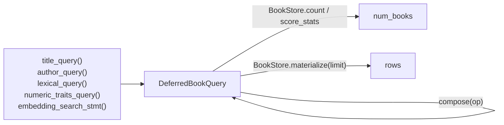

# db/stores

`db.stores` holds one store per table, the only code that runs queries, plus the pure functions that build `books` queries without running them. Routes and workflows never touch a database session directly.

Import from the package root: `from db.stores import BookStore, title_query, DeferredBookQuery`. The other stores are imported by module (`from db.stores.session_store import SessionStore`).

## Who owns the session

A store lives inside one `session_factory.begin()` block, which opens the session, commits on a clean exit and rolls back on an exception. Two things open that block:

- **`ctx.store(SomeStore)`** for anything inside a chat turn. The SSE route returns before any node runs, so a store built at the request would sit on a session that is already closed.
- **`get_sqlalchemy_session`** for the plain HTTP routes, where the request is the unit of work.

Keep the block around the round trip and nothing else: while it is open it holds a pooled connection and a transaction.

Two rules follow, and `tests/unit/db/stores/test_base_store.py` enforces both:

- **No store commits.** The block does. A store that commits closes the transaction early, and the next statement raises `InvalidRequestError`.
- **Every query goes through `BaseStore.execute_statement`**, never `self.session.execute`. It is the one place that applies to every query; today it logs the compiled SQL at DEBUG.

## The stores

| Store | Methods | Called from |
|---|---|---|
| `BookStore` | `count`, `score_stats`, `materialize` | `BookWorkflow` and the similarity node |
| `SessionStore` | `start_turn`, `debit`, `spent_in_last_day` | `token_budget.py`, via `Orchestrator.run` |
| `ChatRunStore` | `insert_run`, `belongs_to`, `get_all` | `run_recorder` (production only), the feedback and review routes |
| `FeedbackStore` | `upsert_review`, `get_by_chat_id` | the feedback and review routes |

- **`SessionStore.start_turn`** upserts the row and returns the balance in one round trip. **`debit`** subtracts in SQL, because two overlapping turns in one session hold separate database sessions and a read-modify-write would lose one. Both return plain ints rather than the model, because an ORM entity can come back stale from the session's identity map.
- **`ChatRunStore.insert_run`** only stages the row; the block commits it. **`get_all`** is the review queue: least-reviewed first, newest first within a tie.

## Deferred book queries

A retrieval node does not fetch its books. It builds a query, counts it, and hands the query downstream on its output.

- **Builders are module-level pure functions** in `book_store.py`. They need no session, so a node can build, record and compose a query without holding a connection. `BookStore` is only the half that runs them.
- **Everything derived from a built query lives on `DeferredBookQuery`** (`deferred_query.py`): `count_stmt()`, `materialize_stmt()`, and `compose()`, which folds several queries into one `WITH` clause (`"and"` intersects, `"or"` pools, both deduped by isbn13).
- **`materialize()` is the only place rows are fetched**: a node's capped `preview` and the similarity node's anchors.
- **A query selects isbn13 plus an optional `score`, with no LIMIT and no ORDER BY.** That is what makes two of them composable, so don't add either when building one. Without a score, rows are ranked by rating; `numeric_traits_query` has none, and `lexical_query` has one only when there are keywords.

**The one exception is `embedding_search_stmt`.** It keeps its ORDER BY and LIMIT, because a vector search orders the whole table and truncates, so the cap is the pool. `score_stats()` is how to count it, since `count()` would only report the LIMIT. Nothing on the class marks the exception, and `compose()` does not refuse it:

- **`compose(op="and")` is safe.** It carries the `score` through, so `Combine_Intersect` can narrow a similarity pool and keep cosine order. The count means "of the 250 nearest, N also match".
- **`compose(op="or")` is lossy.** The LIMIT changes which books qualify, and the score is dropped. Nothing registered pools a query yet. Before `Combine_Union` is registered, tune the similarity floor so the pool needs no LIMIT, or add a guard. See [docs/design/execution-pipeline-v1.md](../../../docs/temp_docs/design/execution-pipeline-v1.md).

`compile_sql` renders a statement for the record, collapsing a pgvector literal (43KB of floats) to a label.
