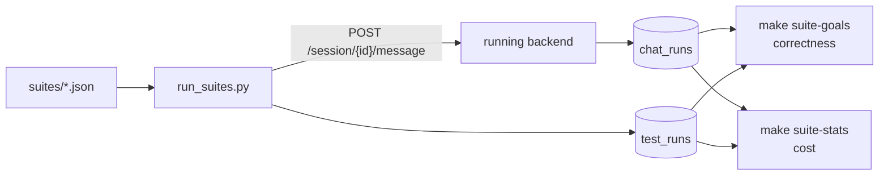

# evals

BookShelf's evals grade the LLM calls that decide what a turn does: the planner, triage's router and the message check. Each has a folder of versioned case suites, a script that runs them, and a report. Why it is built this way and where it is headed: [docs/strategies/evals.md](../../docs/strategies/evals.md).

| Folder | Grades | Needs |
|---|---|---|
| `planjane/` | the planner, through the whole running app: which nodes it planned for each case | a running backend and the database |
| `triage/` | triage's router alone: which tool it picked | an OpenAI key only |
| `validation/` | the message check alone: which reply the user would get | an OpenAI key only |
| `app_docs/` | not an eval: notebooks sizing and building the project-docs vector store, plus past campaign results | |

## Layout

The folders don't follow one pattern yet, because each was built separately. An eval here is meant to have three parts:

- a **suite** of versioned cases;
- a **runner** that sends each case to the node or call under test;
- a **report** that grades the results.

`triage/` and `validation/` have all three, with the report printed by the runner. `planjane/` splits them differently: its runner goes through the whole running app, and its two reports read the database. No node under `app/domains/` has an eval of its own yet.

`common.py` is the plumbing the planner reports share. It sits here rather than in `planjane/` because a script puts its own folder first on `sys.path`, and a `common.py` there would shadow the backend's `common` package.

Every command below runs from `backend/`. `CAMPAIGN=<name>` on any report files it under `evals/results/<name>/`.

## Planner (`planjane/`)



| Suite | Cases | Targets |
|---|---|---|
| `query_suite.json` | 80 | the core node set, easy to hard |
| `query_suite_adversarial.json` | 54 | rejection behaviour; 17 cases expect no nodes |
| `query_suite_stress.json` | 9 | long messages and confusing chains |
| `query_suite_extended.json` | 48 | a larger catalog; its nodes exist only in `playground/app_mock`, so it is dormant |

A case has `id`, `query`, `difficulty`, `expected_nodes` and `note`.

**Run** (start the backend first with `make dev`):

```bash
make query-suite                # the base suite
make query-suite-adversarial    # also -stress, -extended
make query-suite-all            # all four at once (also a concurrency test); -all-seq, -all-tmux
make query-suite-smoke          # first 3 cases, no sleep: the debug loop
make query-suite LIMIT=3 SLEEP=0 ARGS="--ids 1 16"
```

The runner waits 45s between cases to stay under the OpenAI rate limit; `SLEEP=0` turns that off for a short run. It reuses one session per run, named `test_<uuid8>` so eval traffic is easy to filter, and writes each case's `test_runs` row as soon as the case finishes, so an interrupted run keeps what it completed. A long run can exhaust that session's token budget; pass `ARGS="--new-session-per-query"`. Logs go to `evals/logs/query_suites/`.

**Report:**

```bash
make suite-goals     # correctness: each case's planned nodes against expected_nodes
make suite-stats     # cost: ok/failed, duration, tokens, cache hit rate, dollars per model
make suite-reports   # both
make suite-reports CAMPAIGN=v1_baseline   # -> results/v1_baseline/system_goals.md + report.md
```

Both read the latest run per case; `ARGS="--all"` reads every run, `ARGS="--suite <stem>"` narrows to one suite. The goals report is the project's golden test and has no numbers that change run to run, so its diffs stay readable.

Dollar figures are the `cost_usd` stamped on each run when it was recorded, so re-running a report never reprices old runs. A run with no cost counts as unpriced, never as free. A model missing from the [price table](../airglider/src/config.py) makes the report warn that costs are understated.

**Tool catalog:**

```bash
make tools-catalog
make tools-catalog ARGS="--model gpt-5-nano"
```

`tools_catalog.py` reads the live registry instead of the database, so it needs no backend and no recorded run. It reports the tool count per tier, each tool's `Purpose:` line and token cost, and what the catalog costs per request, cached and uncached. It also flags nodes registered with no executor and docstrings missing a section (`Do not use:` and `Example queries:` are the ones that prevent misroutes). Run it after adding or editing a node.

## Router (`triage/`)

```bash
make eval-routing                        # every case
make eval-routing ARGS="--ids 101 409"   # a few, while iterating
make eval-routing ARGS="--save"          # also writes triage/results/route_query_<timestamp>/
```

`eval_route_query.py` sends each case in `suites/route_query.json` through `build_route_request`, the same builder a real turn uses, straight to OpenAI. The prompt is read from disk on every call, so editing `route_query.txt` and rerunning is the whole loop. The suite costs about three cents.

A case passes when the route is one of its `expected`: `PlanJane`, `ProjectInfoArgs`, `ClarifyingQuestion`, `SecurityReview`, or `reply` when the model answered in text. Several tool calls make one route, sorted and joined (`PlanJane + ProjectInfoArgs`). Arguments are not graded, except that a split's `PlanJane.message` is what the planner reads, so check the detail column on those. The report separates book asks kept from the planner from misuse let through, and prints every direct reply in full, since those words reach the user unedited.

Case ids are grouped by route: 1xx plan, 2xx reply, 3xx clarify, 4xx security, 5xx mixed, 6xx project facts. Off-topic asks expect `PlanJane`, because the router clarifies only what is unclear, not what is unsupported. A follow-up expects `ClarifyingQuestion` unless it stands alone, since the router sees no earlier turns.

## Message check (`validation/`)

```bash
make eval-validation
make eval-validation ARGS="--ids 304 403"
make eval-validation ARGS="--save"       # also writes validation/results/validate_message_<timestamp>/
```

Built like the router eval: each case in `suites/validate_message.json` goes through `build_validation_request` to OpenAI. A case passes when the reply the user would get is one of its `expected`: `pass`, `harmful` or `incoherent`. The report separates wrongly refused from wrongly passed and gives each failure's `reasoning`.

The check does not look at code, prompt injection or language, so those cases (3xx, 4xx, 605 to 608) record what reaches triage. Keep cases out of the prompt's examples, so the suite tests the rules rather than recall.

## Campaigns

A campaign is one folder under `results/<name>/`: the reports (`CAMPAIGN=<name>`), the raw `chat_runs` and `feedback` dumps (`make postgres-dump-chat-runs-cascade`; dump before clearing, because `test_runs` cascades away with `chat_runs`), and a hand-written review. Past campaigns are in `app_docs/results/`.
