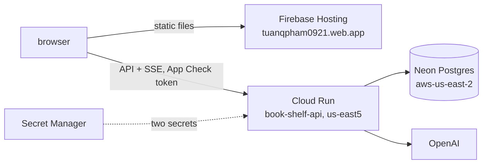

# Deployment strategy

BookShelf is deployed as three managed pieces that cost almost nothing when idle: the backend on Cloud Run, the database on Neon and the frontend on Firebase Hosting. The commands are in [backend/](../../backend/README.md#deploy) and [frontend/](../../frontend/README.md#deploy); the database half is in [database.md](database.md).

## What runs where

| Piece | Shape |
|---|---|
| Cloud Run `book-shelf-api` | project `tuanqpham0921`; cpu 1, 1 GiB, cpu boost, 300s timeout, 0 to 3 instances, concurrency 5 |
| Identity | its own service account, not the compute default (which has project Editor); it needs only secret access on the two secrets |
| Startup probe | `GET /ready`, a real `SELECT 1`, so a revision that can't reach the database never takes traffic |
| OpenAI | production has its own key, separate from the one `make dev` uses |
| Frontend | Firebase Hosting target `book-rec`; the backend URL is committed in `frontend/.env.production` |

## Choices

- **One file describes production.** The git-ignored `backend/config/.env.deployment` holds the service's shape (`DEPLOY_*`) and every env var but the two secrets. The `deploy` recipe reads it, and so does `make dev-neon`, so the deployed database and local Neon runs can't drift, and the endpoint stays out of the public repo. The cost: a fresh clone can't deploy without that file.
- **No `cloudbuild.yaml`.** `gcloud run deploy --source` already runs Cloud Build and pushes to Artifact Registry, so the file would only restate the Dockerfile and the flags.
- **Secrets never enter the revision's env.** `POSTGRES_PASSWORD` and `OPENAI_API_KEY` come from Secret Manager through `--set-secrets` (revisions are immutable and readable forever), so the recipe holds no credential and is safe to commit.
- **Scale to zero.** Minimum instances is 0, so the first chat after a quiet spell pays a 5–8s cold start. One warm instance would remove it for about $7 a month, and warms the container, not the database.
- **One sink per environment for recorded turns.** Production inserts a `chat_runs` row, development writes JSON under `logs/`, tests write nothing. Files are never the production sink, because Cloud Run's filesystem is in memory. Recording never costs the user their reply.
- **The image runs as non-root on a read-only `/app`,** so a stray write fails loudly. It therefore boots only as production (development writes a log file); local development is `make dev`, not the image. The rest of the image's choices are comments in the [Dockerfile](../../backend/Dockerfile).
- **Two ignore files with different rules.** `.dockerignore` uses Docker's matcher; `.gcloudignore` uses gitignore rules, so every line is anchored with `/`, and it keeps the `Dockerfile` because Cloud Build needs it. Without a `.gcloudignore`, gcloud writes one for you.

## Security and spend

V1 has no user auth; why, and what stands in for it, is [decision 009](../decisions/009-no-user-auth-in-v1.md). The layers, outside in:

| Layer | Limits |
|---|---|
| OpenAI account | a hard monthly spend cap |
| Cloud Run | concurrency 5 × 3 instances as a throughput ceiling; `make deploy-off` as a kill switch |
| CORS | exact origins only (both Firebase hostnames); `GET, POST, PUT, OPTIONS`; only the headers `api.js` sends |
| App Check | every route but the health checks needs a token from the site; a Cloud Run revision without `APP_FIREBASE_PROJECT_NUMBER` refuses to boot |
| Per IP | a message limit per hour, per instance (production only) |
| Site-wide | a daily token cap across every session (production only) |
| Per session | a token budget, in every environment |
| Per message | a length cap on messages and on feedback comments |
| Review routes | not served in production |

## Risks

- **The books data has three copies:** the local container, the 67 MB dump in `backend/data/backup/` and Neon. Re-embedding 5,197 books costs real OpenAI spend, and `data/books.csv` has no vectors. Keep the dump.
- **There is no continuous deployment.** `.github/workflows/ci.yml` already has the env block it would need.
