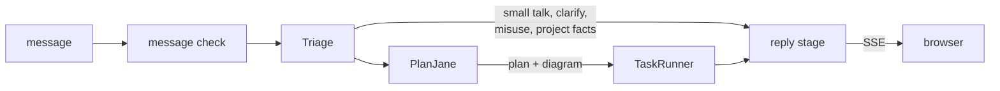

# BookShelf V1

BookShelf V1 is a small, polished set of book-finding capabilities built to show off the planner and its orchestration: books are the demo domain, and the planner is the point. This page is the technical record of what V1 does, how it is designed and what comes after it. The about pages on the site are the readable version and draw from here.

**Live at** [tuanqpham0921.web.app](https://tuanqpham0921.web.app).

## Scope

V1 is more about the foundation than the feature list. It sets up a structure that is easy to develop on and flexible to change: a new capability is one slice, a node's model or prompt changes without touching the others, every step is traced, and the evals say whether a change broke anything. The capabilities are kept small so that structure is the focus. Two parts are already built to be lifted out: airglider imports nothing from the app, and PlanJane's diagram code (`dial/`) imports only airglider, so each can become its own package.

- **In:** retrieval and similarity over a fixed catalog, a plan the user can see before it runs, an answer for unclear or misused messages instead of a quiet failure, feedback on each answer, and clean single-turn conversation.
- **Out:** user accounts, so no preferences, saved books or reading history; internet search; the model's own knowledge of books.
- **Frontend:** remove features rather than add them.

## Capabilities

Seven nodes are registered, all with real executors. `make tools-catalog` prints the live list.

| Node | Finds |
|---|---|
| `Retrieve_by_Title` | a book the user named |
| `Retrieve_by_Author` | an author's books |
| `Retrieve_by_Lexical_Traits` | books whose text has these words, by fiction-ness and audience |
| `Retrieve_by_Numeric_Traits` | books within bounds on pages, year, rating or ratings count |
| `Analyze_Similar_Books` | books close in meaning to named ones |
| `Combine_Intersect` | the books every earlier search found |
| `Retrieve_Project_Info` | answers about BookShelf itself, from its own docs |

Before the planner, the message check refuses harmful or gibberish messages, and triage answers small talk, asks clarifying questions, turns misuse away and looks up project facts. After it, the reply stage tells the user which parts were out of scope.

### How a plan behaves

- **The planner declines instead of guessing.** A goal is refused when its confidence is under 0.5, or when the planner marks it `unknown` because no node fits. At most 10 goals are accepted; any beyond that are buffered. A goal that can never run, because of a cycle or a refused dependency, is reported as unreachable, not dropped.
- **Similarity order survives an intersect.** For "books like The Alchemist with more than 300 pages", the similarity node keeps the 250 nearest books and the intersect bounds them without losing their ranking, so the count means "of the 250 nearest, N have more than 300 pages" ([decision 005](decisions/005-counts-first-retrieval.md)).
- **A turn never ends silently.** A turn has 120 seconds. If the reply stage fails, the user still gets an error message rather than a stream that stops on the task sections. Recording a turn never costs the user their reply, and out-of-scope parts get their own sentence in the reply.

### Limitations

- **Single-turn.** Each message stands alone. Turns are recorded but never read back, so a follow-up with no earlier turn gets a clarifying question.
- **Only what a `books` row holds:** author, year, pages, rating, shelf, genre and a marketing blurb. Nothing in the catalog knows what happens inside a book.
- **Mood and feel are dropped.** Lexical search matches words, and similarity takes only books the user named, so "cozy mysteries" searches for mysteries.
- **Goals the planner refuses get no reply of their own.** A turn whose goals are all refused ends in a generic error.
- **A mis-routed goal can parse anyway** ([decision 011](decisions/011-node-refusal.md)).

### Docs and the chatbot

The READMEs and `docs/` are built into the chat assistant, so a developer can ask it how BookShelf works, such as how a node is added or why retrieval counts first, instead of hunting through folders. That makes onboarding and day-to-day development faster, and it keeps the docs honest: a wrong page shows up as a wrong answer.

`Retrieve_Project_Info` answers from a vector store over the READMEs and `docs/`, so those pages are written for a reader who gets one chunk at a time ([documentation strategy](strategies/documentation.md)). The store is loaded by hand today.

**The search is OpenAI file search, not pgvector.** OpenAI chunks, embeds and indexes the docs, so there is no second index to keep in the database beside the book embeddings. The node calls the store's raw search (`vector_stores.search`) for the 10 closest chunks, then answers in a call of its own that can reject, instead of using the hosted `file_search` tool that would search and answer in one step. How it is set up is in [the project domain](../backend/app/domains/project/README.md#search-openai-file-search); OpenAI's own guides are [Retrieval](https://developers.openai.com/api/docs/guides/retrieval) and [File search](https://developers.openai.com/api/docs/guides/tools-file-search).

## Architecture

How a request flows is in [backend/app/](../backend/app/README.md). The choices that shape it:

| Choice | Record |
|---|---|
| The planner picks capability nodes, and each node hears only its instruction | [002](decisions/002-capability-nodes.md) |
| One dimension per node, composed by intersect | [003](decisions/003-one-dimension-nodes.md) |
| Books the user named are anchors; everything else is a candidate | [004](decisions/004-anchors-and-candidates.md) |
| Retrieval counts and hands on a query; rows are fetched only for previews | [005](decisions/005-counts-first-retrieval.md) |
| One reply stage per turn, written from every goal's result | [006](decisions/006-one-reply-stage.md) |
| Every step is traced as a tree by airglider | [001](decisions/001-airglider-step-semantics.md) |

**The plan already allows concurrent tasks.** `PlanJaneOutput.execution_order()` groups goals into layers where no goal depends on another in the same layer, so a layer can run concurrently for a faster turn. The task runner runs them one at a time today; running a layer at once is a change to the runner alone.

### Human in the loop

Proposed, not built: pause after the plan ("continue?"), persist the run, and resume from the next message with nothing held alive in between ([decision 010](decisions/010-human-in-the-loop.md)). It is the highest-value feature left.

### Conversation continuation

V1.1's flagship. `chat_runs` already records each turn and its results, which is what a later turn would read. It needs history loading, prompt changes and a running summary. **The reply prompt says the opposite today** (`write_reply/prompts/reply.txt` says the system keeps no memory between messages, and its no-questions rule leans on that), so that has to be unwound first.

### Caching Strategies

Each layer chooses its own caching:

- **Promoted tools.** Any node can be offered to triage as a tool, so a common ask skips the planner and its whole catalog. `Retrieve_Project_Info` is the one promoted today.
- **Prompt-level caching.** Each node builds its own LLM request, so it can keep its prompt's opening byte-identical and let OpenAI's prompt cache serve it. The planner's catalog is the main case. `make suite-stats` reports the hit rate.
- **Plan replay.** Triage replays recorded plans for a short list of fixed messages (`orchestration/triage/cache.py`), in every environment. The user is told it is a cached plan ("I have this query cached. Let me use this to save tokens."), so the shortcut is visible.

Nothing caches an embedding, a search result or a reply.

### Security

There is no user auth in V1; the review routes are off in production, and App Check plus spend caps stand in ([decision 009](decisions/009-no-user-auth-in-v1.md)).

Misuse is checked in layers. The message check refuses harmful or gibberish messages, then triage's router turns misuse away with `SecurityReview`. `SecurityReview` and `ClarifyingQuestion` are common tools (`app/common/tools.py`), so any node can offer them in its own LLM call: to flag the part of its instruction that is misuse and carry on with the rest, or to ask the user rather than guess. Today only triage offers them.

**Each node gets only its own context.** A node hears its instruction from the planner and the typed results it depends on, never the user's whole message or another node's prompt. An injected string has to survive the planner's rewrite to reach a node, and what each node sees can be widened or narrowed per node. The same isolation keeps prompts small: no node pays for context it doesn't use.

**Each node can refuse.** A node that is handed work it shouldn't do raises, which ends that goal as a failure, not a crash of the turn: the reply explains it from the goal's `FailedGoalOutput`. Today that failure is recorded as a runtime error; marking it as a business failure, so it can be told apart from a real crash, is [decision 011](decisions/011-node-refusal.md).

Triage fails open, and a node's parsed arguments, where an injected string would land, have no tests of their own.

## Evaluation

The steps of a turn talk to each other in natural language: the planner writes each goal as a plain instruction, and each node parses its own arguments from it. That keeps testing simple:

- **Each node can be tested on its own,** by handing it an instruction and its inputs, with no planner and no rest of the turn.
- **The planner is the one place correctness is decided.** If PlanJane picks the right nodes, in the right order, with self-contained instructions, the nodes do the rest. The golden test (`make suite-goals`) grades exactly that.

**PlanJane runs on a frontier model, `gpt-6-sol`,** chosen after evaluation. It is the one call that sees the whole catalog, so accuracy matters most there, and the cost stays low: the catalog is identical on every request, so the cache hit rate is high, and the output is a short list of goals, so few tokens are written. It was also the easiest of the candidates to test against.

**The planner has room to grow.** It was tested against a catalog of about 30 node types (the extended suite) and performed decently for this project. With seven registered today, that leaves a lot of room.

**Four planner suites:** base, adversarial, extended (the larger catalog) and stress.

How the evals are built and what none of them covers yet: [eval strategy](strategies/evals.md).

## Frontend Design

- **Bookish, in black and white.** A serif typeface on a black, white and gray palette, so it reads like a printed page. Color is added only where it helps a section read more easily. The palette is tokens in `styles/tokens.css`.
- **Looking through the AI.** The chat sits in a translucent white panel, so the work shows through rather than being hidden behind an answer.
- **Every step can be inspected.** The plan diagram comes first, then one folded section per goal with its task result: the arguments the node parsed, its SQL, its cost and a preview of the books. The reply stays open below them.
- **The log and sources reach the browser.** Each turn's full trace and, for project questions, the docs the answer came from are sent to the frontend, behind the log and Sources buttons.
- **Cards follow the text.** The reply is paragraphs and the cards they mention, so only books the text points at are shown.
- **Suggestions that invite breaking it.** The suggested prompts come in four tabs: quick suggestions, unsupported asks (compare, ISBN, a random pick, preferences), project questions, and security probes (prompt injection, other users' data, harmful asks). Showing where it fails is part of the transparency.
- **Feedback per answer:** thumbs and comments.
- **One page, one view per path,** each loaded on first visit and kept mounted.

How a turn renders: [frontend/src/](../frontend/src/README.md).

## Abuse prevention

Every turn spends OpenAI money, and anyone can open the site. The limits a user can run into:

- **Each session has a token budget** and is refused once it is spent. A turn is never cut off midway, so a session can go one turn over.
- **The whole site has a daily token budget**, in production.
- **Each IP has an hourly message limit**, in production.

The token budgets are env settings (`APP_SESSION_TOKEN_BUDGET`, `APP_SITE_DAILY_TOKEN_BUDGET`), kept internal: a user is told a limit was reached, never its size. The per-IP limit is in `config/constants.py`.

All the limits, from the OpenAI account cap down to the per-message length cap, are in the [deployment strategy](strategies/deployment.md#security-and-spend). `make deploy-off` revokes public access without deleting anything.

## Cost

**A turn costs at least about one cent,** most of it the planner. `make suite-stats` reports the spend per run and per model.

**Affiliate links could pay for it (not built).** A $10 book bought through an affiliate link earns about $0.45 to $1, at a 4.5% to 10% commission. At a cent a turn, one sale covers roughly 45 to 100 turns.

**There is plenty of room to make turns cheaper:**
- shorter node specs, since the planner reads every one on every request;
- more caching;
- more promoted tools, so more asks skip the planner.

None of these is in V1. The evals and the small amount of real traffic can't yet show that a cheaper turn is still a correct one.

## Release checklist

- [x] Every registered node plans and executes end to end with real data over SSE.
- [~] Ambiguous or unsupported input always gets a clarification or rejection: done in triage and the message check; refused planner goals are still open.
- [ ] Suites re-baselined and passing their thresholds via `make suite-goals` ([eval strategy](strategies/evals.md)).
- [~] Security blockers closed: the review surface is off in production; `uuid_8`'s 32-bit ids remain ([backlog](backlog.md)).
- [ ] READMEs, CLAUDE.md and `docs/` accurate against the code.
- [x] Chat feedback works, with an ownership check.

## Next

1. **Project questions in production:** confirm a live lookup, then fix its token costs ([backlog](backlog.md)).
2. **A reply for refused goals.**
3. **The golden-test gate.**
4. **Human-in-the-loop,** pause point A first.
5. **UI polish** from the backlog.

## Future plans

**User features** (all need accounts and a user database):
- multi-turn conversation;
- preferences, saved books and reading history;
- a public review page, behind real auth.

**Backend:**
- the designed-but-unbuilt nodes ([node strategy](strategies/nodes.md#designed-not-built)), and a single-book analyze node for book questions and compare;
- book-clamped recommendations ("do you have Dune?" — "yes, and you'll like these");
- node refusal;
- running independent goals concurrently;
- a checkpoint or re-plan node, so a turn can stop, check what it found, and plan again: the step toward agentic conversation continuation;
- retries, checkpointing and a server-side stop in airglider;
- shorter prompts and fewer project-doc tokens;
- an entity-first planner as a V2 cost option.

**Frontend:**
- accessibility fixes (keyboard paths for dropdowns and the nav overlay);
- scrollable sidebars;
- mermaid sizing on small screens;
- a cleaner review page.
