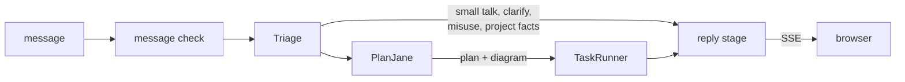

# BookShelf V1

BookShelf V1 is a small, polished set of book-finding capabilities built to show off the planner and its orchestration: books are the demo domain, and the planner is the point. This page is the technical record of what V1 does, how it is designed and what comes after it. The about pages on the site are the readable version and draw from here.

**Live at** [tuanqpham0921.web.app](https://tuanqpham0921.web.app).

## Scope

- **In:** retrieval and similarity over a fixed catalog, a plan the user can see before it runs, an answer for unclear or misused messages instead of a quiet failure, feedback on each answer, and clean single-turn conversation.
- **Out:** user accounts, so no preferences, saved books or reading history; internet search; the model's own knowledge of books.
- **Frontend:** remove features rather than add them.

## Capabilities

Seven nodes are registered, all with real executors. `make tools-catalog` prints the live list.

| Node | Finds |
|---|---|
| `Retrieve_by_Title` | a book the user named |
| `Retrieve_by_Author` | an author's books |
| `Retrieve_by_Lexical_Traits` | books whose text has these words, by fiction-ness and audience |
| `Retrieve_by_Numeric_Traits` | books within bounds on pages, year, rating or ratings count |
| `Analyze_Similar_Books` | books close in meaning to named ones |
| `Combine_Intersect` | the books every earlier search found |
| `Retrieve_Project_Info` | answers about BookShelf itself, from its own docs |

Before the planner, the message check refuses harmful or gibberish messages, and triage answers small talk, asks clarifying questions, turns misuse away and looks up project facts. After it, the reply stage tells the user which parts were out of scope.

### Limitations

- **Single-turn.** Each message stands alone. Turns are recorded but never read back, so a follow-up with no earlier turn gets a clarifying question.
- **Only what a `books` row holds:** author, year, pages, rating, shelf, genre and a marketing blurb. Nothing in the catalog knows what happens inside a book.
- **Mood and feel are dropped.** Lexical search matches words, and similarity takes only books the user named, so "cozy mysteries" searches for mysteries.
- **Goals the planner refuses get no reply of their own.** A turn whose goals are all refused ends in a generic error.
- **A mis-routed goal can parse anyway** ([decision 011](decisions/011-node-refusal.md)).

### Docs and the chatbot

`Retrieve_Project_Info` answers from a vector store over the READMEs and `docs/`, so those pages are written for a reader who gets one chunk at a time ([documentation strategy](strategies/documentation.md)). The store is loaded by hand today.

## Architecture

How a request flows is in [backend/app/](../backend/app/README.md). The choices that shape it:

| Choice | Record |
|---|---|
| The planner picks capability nodes, and each node hears only its instruction | [002](decisions/002-capability-nodes.md) |
| One dimension per node, composed by intersect | [003](decisions/003-one-dimension-nodes.md) |
| Books the user named are anchors; everything else is a candidate | [004](decisions/004-anchors-and-candidates.md) |
| Retrieval counts and hands on a query; rows are fetched only for previews | [005](decisions/005-counts-first-retrieval.md) |
| One reply stage per turn, written from every goal's result | [006](decisions/006-one-reply-stage.md) |
| Every step is traced as a tree by airglider | [001](decisions/001-airglider-step-semantics.md) |

### Human in the loop

Proposed, not built: pause after the plan ("continue?"), persist the run, and resume from the next message with nothing held alive in between ([decision 010](decisions/010-human-in-the-loop.md)). It is the highest-value feature left.

### Conversation continuation

V1.1's flagship. `chat_runs` already records each turn and its results, which is what a later turn would read. It needs history loading, prompt changes and a running summary. **The reply prompt says the opposite today** (`write_reply/prompts/reply.txt` says the system keeps no memory between messages, and its no-questions rule leans on that), so that has to be unwound first.

### Caching Strategies

Each layer chooses its own caching:

- **Promoted tools.** Any node can be offered to triage as a tool, so a common ask skips the planner and its whole catalog. `Retrieve_Project_Info` is the one promoted today.
- **Prompt-level caching.** Each node builds its own LLM request, so it can keep its prompt's opening byte-identical and let OpenAI's prompt cache serve it. The planner's catalog is the main case. `make suite-stats` reports the hit rate.
- **Plan replay.** Triage replays recorded plans for a short list of fixed messages (`orchestration/triage/cache.py`), in every environment.

Nothing caches an embedding, a search result or a reply.

### Security

There is no user auth in V1; the review routes are off in production, and App Check plus spend caps stand in ([decision 009](decisions/009-no-user-auth-in-v1.md)).

Misuse is checked in layers. The message check refuses harmful or gibberish messages, then triage's router turns misuse away with `SecurityReview`. `SecurityReview` and `ClarifyingQuestion` are common tools (`app/common/tools.py`), so any node can offer them in its own LLM call: to flag the part of its instruction that is misuse and carry on with the rest, or to ask the user rather than guess. Today only triage offers them.

Triage fails open, and a node's parsed arguments, where an injected string would land, have no tests of their own.

## Frontend Design

- **Bookish, in black and white.** A serif typeface on a black, white and gray palette, so it reads like a printed page. Color is added only where it helps a section read more easily. The palette is tokens in `styles/tokens.css`.
- **Looking through the AI.** The chat sits in a translucent white panel, so the work shows through rather than being hidden behind an answer.
- **Every step can be inspected.** The plan diagram comes first, then one folded section per goal with its task result: the arguments the node parsed, its SQL, its cost and a preview of the books. The reply stays open below them.
- **The log and sources reach the browser.** Each turn's full trace and, for project questions, the docs the answer came from are sent to the frontend, behind the log and Sources buttons.
- **Cards follow the text.** The reply is paragraphs and the cards they mention, so only books the text points at are shown.
- **Feedback per answer:** thumbs and comments.
- **One page, one view per path,** each loaded on first visit and kept mounted.

How a turn renders: [frontend/src/](../frontend/src/README.md).

## Abuse prevention

Every turn spends OpenAI money, and anyone can open the site. The limits, from the OpenAI account cap down to the per-message length cap, are in the [deployment strategy](strategies/deployment.md#security-and-spend). `make deploy-off` revokes public access without deleting anything.

## Release checklist

- [x] Every registered node plans and executes end to end with real data over SSE.
- [~] Ambiguous or unsupported input always gets a clarification or rejection: done in triage and the message check; refused planner goals are still open.
- [ ] Suites re-baselined and passing their thresholds via `make suite-goals` ([eval strategy](strategies/evals.md)).
- [~] Security blockers closed: the review surface is off in production; `uuid_8`'s 32-bit ids remain ([backlog](backlog.md)).
- [ ] READMEs, CLAUDE.md and `docs/` accurate against the code.
- [x] Chat feedback works, with an ownership check.

## Next

1. **Project questions in production:** confirm a live lookup, then fix its token costs ([backlog](backlog.md)).
2. **A reply for refused goals.**
3. **The golden-test gate.**
4. **Human-in-the-loop,** pause point A first.
5. **UI polish** from the backlog.

## Future plans

**User features** (all need accounts and a user database):
- multi-turn conversation;
- preferences, saved books and reading history;
- a public review page, behind real auth.

**Backend:**
- the designed-but-unbuilt nodes ([node strategy](strategies/nodes.md#designed-not-built)), and a single-book analyze node for book questions and compare;
- book-clamped recommendations ("do you have Dune?" — "yes, and you'll like these");
- node refusal;
- retries, checkpointing and a server-side stop in airglider;
- shorter prompts and fewer project-doc tokens;
- an entity-first planner as a V2 cost option.

**Frontend:**
- accessibility fixes (keyboard paths for dropdowns and the nav overlay);
- scrollable sidebars;
- mermaid sizing on small screens;
- a cleaner review page.
